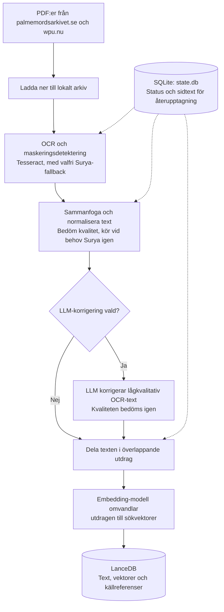
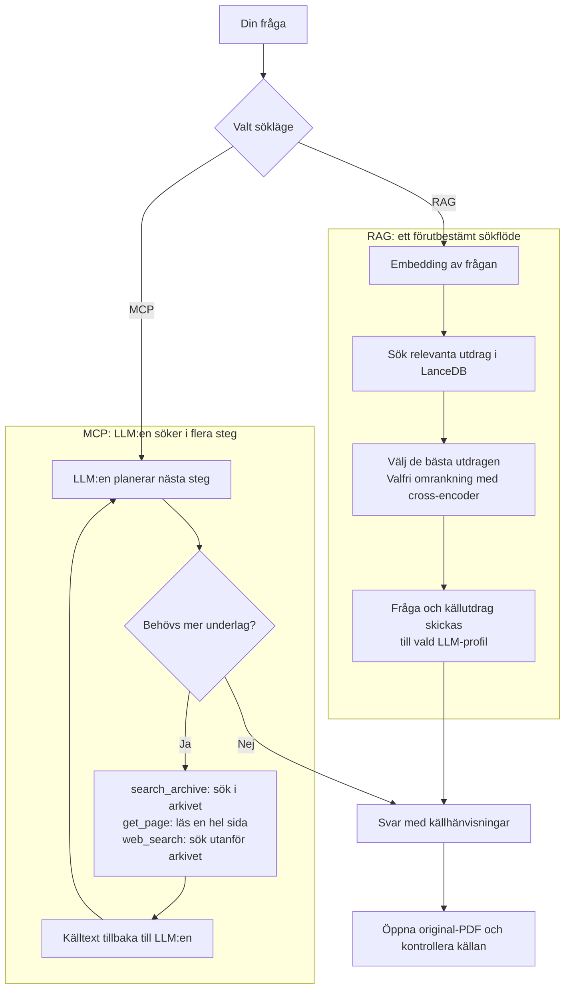

# Teknisk referens

[← Översikt](../README.md) · [Kom igång](kom-igang.md)

Detaljerad dokumentation av alla pipeline-steg, flaggor och delsystem. För en
snabbstart, se [Kom igång](kom-igang.md).

## State-databas (`generated/db/state.db`)

Alla pipeline-markörer och status lagras i SQLite (`generated/db/state.db`).
Inspektera med t.ex. `sqlite3 generated/db/state.db`. Tabellerna:

- `downloads` — palmemordsarkivet- och wpu-nedladdningar (Drive-ID eller URL, sha1 där det finns, filename, bytes)
- `pdf_files` — per-PDF-status (redaction_checked_at, merged_at, normalized_at, text_mtime, tesseract_done_at, tesseract_failed, tesseract_blacklisted_at, surya_failed_at)
- `pdf_pages` — per-sida OCR-resultat (text, engine, score; för motorn `surya-layout` även `markdown` — `NULL` för tom sida —, `layout_json` med blocklayouten — `{"dpi": N, "blocks": [...]}`, där `dpi` är upplösningen sidbilden faktiskt renderades i; rader från före renderingstaket är en ren blocklista och läses som 300 dpi — och `engine_identity` med workerns `--identity`-svar). Äldre rader kan ha `text = NULL` (markörer); då är sidan i `generated/text/<stem>.txt` den gällande läsningen
- `pdf_page_readings` — historik över tidigare läsningar av en sida (motor, text, Markdown, layout, motoridentitet, poäng, `reason` = `rescan`/`restore`). `rescan-page` sparar den gällande läsningen här innan den skrivs över, så att en sämre omskanning kan återställas
- `quality` / `quality_pages` — kvalitetspoäng per fil och sida
- `ingest` — vad som indexerats i LanceDB och med vilken text_mtime
- `llm_corrections` — vilka sidor som LLM-korrigerats
- `wpu_decisions` — vilka wpu-stems `merge_wpu` redan fattat beslut för
- `doc_entities` — extraherade entiteter/relationer per sida (kunskapsgrafen)
- `casebook_entries` — sparade fråga/svar-spår från webgränssnittets utredningspärm
- `source_bookmarks` — bokmärkta källor från källlistorna i webgränssnittet
- `source_annotations` — utredarens fritextanteckningar knutna till en källa/sida (flera per källa tillåts)
- `map_places` — platskatalog för Karta-flikens snabbval
- `map_observations` — källhänvisade observationer med person, koordinat, tid (`HH:MM`), osäkerhet, `nr`, `sida` och notering; `src/karta.py` tolkar tiden mot basdatum `1986-02-28` när `TimestampedGeoJson` byggs
- `map_observation_candidates` — granskningskö för LLM-extraherade kartförslag. Raderna har `status` (`pending`, `approved`, `rejected`) och blir inte publicerade kartobservationer förrän `approve_map_observation_candidate` skapar en rad i `map_observations`
- `map_observation_extractions` — per-sida-markör för kartobservations-extraktionen. Även sidor där LLM:en hittar noll kandidater markeras här så omkörningar inte skickar samma tomma sida igen
- `llm_usage` — ackumulerade token och kostnader per LLM-profil (en rad per profil, `calls`/`input_tokens`/`output_tokens`/`cache_hit_tokens`/`cost_usd`/`cost_partial`/`last_model`). Räknas upp av Utredningssidans anrop och visas både i sidofältet och i Admin → Inställningar

Schemat är versionsstyrt i `src/db/_schema.py`. `init_schema(conn)` skapar en färsk
databas direkt, migrerar äldre databaser via pending migrations och skriver
aktuell version både till tabellen `schema_version` och `PRAGMA user_version`.
Om databasen har högre version än koden stödjer avbryts initieringen med fel,
så äldre kod inte tyst skriver mot ett nyare schema.

**Livscykel:** radera inte `generated/db/state.db` mitt under en pågående
pipeline-körning — befintliga processer fortsätter skriva mot den unlinkade inoden
medan nya processer skapar en tom db, vilket ger inkonsekvent state.
Om databasen däremot saknas när `scripts/ingest.py` startar identifieras befintliga
LanceDB-källor och ersätts i stället för att dupliceras.

## Vad install.py gör

`scripts/install.py` sköter pipeline- och webgränssnittsberoendena via Homebrew och pip:

- `ocrmypdf`, `tesseract-lang`, `poppler`, `unpaper`, `hunspell` via brew
- sv_SE-ordlista länkad till `~/Library/Spelling/` (för qualitets-scoring)
- `.venv/` med `pip install -e .[web]` (bl.a. Streamlit, `folium` och `streamlit-folium`)
- med `--dev`: `.venv/` med `pip install -e '.[dev,web]'` så `.venv/bin/python scripts/test.py --static` även kan köra `ruff` och `mypy`
- Laddar ner `swe_best.traineddata` (~12 MB) via `scripts/setup_tessdata.py`

Surya-OCR ingår som standard. Hoppa över det (snabbare install) med:

```bash
.venv/bin/python scripts/install.py --no-surya
```

För utveckling/tester:

```bash
.venv/bin/python scripts/install.py --dev
```

Surya 2-layout har ett eget beroendeträd och installeras bara på begäran:

```bash
.venv/bin/python scripts/install.py --surya-layout
```

Flaggan kräver Homebrew och gör följande (ingenting annat körs, och projektets
`.venv` rörs inte): `brew install llama.cpp uv` för det som saknas,
`uv venv --python 3.12 ~/.local/share/palmemordsarkivet/surya-venv` om venv:en
inte finns, `uv pip install --python <venv>/bin/python 'surya-ocr==0.22.1'` och
sist `<venv>/bin/python src/surya_worker.py --identity` som kontroll. Python 3.12
är avsiktligt: PyTorch-hjulen finns inte för Homebrews nyare Python, så en
3.14-venv installerar ett paket som inte går att importera. En befintlig venv
med en annan Python-version skrivs därför inte över: skriptet avbryter med ett
felmeddelande, och du tar bort katalogen eller låter `PALME_SURYA_PYTHON` peka
på en annan venv. Se
[Surya 2-layout](#surya-2-layout---surya-engine-layout) för miljövariabler och licenser.

> **Beroendepinnar:** `sentence-transformers<5` och `transformers<5` är medvetet pinnade — 5.x-versionerna bryter cross-encoder-laddning och Surya-integrationen.

## Användning

Diagrammet visar huvudstegen; OCR-steget omfattar även sammanslagning av
sidtext och hantering av WPU-material.



SQLite håller reda på vad som redan är gjort, så pipelinen kan återupptas
och bara bearbeta det som behövs. LanceDB lagrar det sökbara indexet.

Alla kommandon nedan skrivs som `.venv/bin/python scripts/X.py …`. Samma kommando
går att skriva `./X.sh …` från projektroten: varje entrypoint har en tunn genväg
med samma namn som bara vidarebefordrar argumenten — se
[Kortkommandon](kom-igang.md#kortkommandon).

### 1. Ladda ner PDF-filerna

```bash
.venv/bin/python scripts/download.py
.venv/bin/python scripts/download.py --dry-run    # lista vad som skulle hämtas
.venv/bin/python scripts/download.py --rebuild    # hämta om allt (ignorera manifestet)
.venv/bin/python scripts/download.py --out files --help
```

- Hämtar Google Sheet som CSV, plockar ut Drive-ID från "Länk till kopia".
- Filnamn blir `<Nr> — <Titel> — <Beställt> — <Upplagt> — <Anmärkning> — <Sidor>.pdf`.
- Korrekt extension via magic-bytes (PDF/JPG/PNG/...).
- Idempotent: hoppa över redan nedladdade. Visar progress + ETA. `--dry-run`
  hämtar inget och skriver inga nedladdningsrader (state.db öppnas för att läsa
  manifestet); `--rebuild` hämtar om även filer som ligger på disk eller står i
  manifestet — använd det om ett dokument saknas lokalt eller fastnat som
  permanent misslyckat.

För hela arkivet (tar några timmar), kör i bakgrunden:

```bash
nohup .venv/bin/python scripts/download.py > log.txt 2>&1 &
```

#### Komplettera med wpu.nu

[wpu.nu](https://wpu.nu/wiki/Dokument) publicerar en del av samma material men ibland med bättre skanningar. Ladda ner hela wpu-samlingen till en separat katalog:

```bash
.venv/bin/python scripts/download_wpu.py          # ladda ner alla PDF:er → downloaded/wpu_files/
.venv/bin/python scripts/download_wpu.py --dry-run  # lista utan att ladda ner
```

Wpu-PDF:er får exakt samma OCR-behandling som palme-PDF:er: `scripts/ocr.py` kör `scripts/ocr_tesseract.py` på `downloaded/wpu_files/` också så varje wpu-fil får sin egen `generated/text/<stem>.txt` och `generated/ocr/<stem>.pdf`. Om Tesseract inte får fram text försöker `scripts/ocr.py` Surya som helfils-fallback innan wpu-merge. Sen kör `scripts/merge_wpu.py` som jämför kvalitetspoäng för matchande dokument-ID och **raderar förlorarens** text- och ocr-filer:

| Jämförelse (margin 5 p) | Utfall |
|---|---|
| wpu vinner | palme-versionens `generated/text/`+`generated/ocr/` raderas |
| palme vinner | wpu-versionens `generated/text/`+`generated/ocr/` raderas |
| inom margin (oavgjort) | båda behålls |
| ingen matchning | wpu står ensam, inget händer |

Om en wpu-PDF saknar text efter både Tesseract och Surya (`surya_failed_at` satt)
hoppar `scripts/merge_wpu.py` över den tyst; vanliga saknade textfiler varnas
fortfarande som resume-problem.

Surya-steget för låga kvalitetspoäng körs sen mot kvarvarande
`generated/text/`-filer och hanterar palme- och wpu-filer identiskt.

```bash
.venv/bin/python scripts/merge_wpu.py             # kör om manuellt (parallellt, default cpu_count)
.venv/bin/python scripts/merge_wpu.py --dry-run   # visa vad som skulle hända
.venv/bin/python scripts/merge_wpu.py --rebuild   # ignorera wpu_decisions-tabellen i state.db
.venv/bin/python scripts/merge_wpu.py --jobs 8    # antal parallella processer
```

### 2. OCR till text

#### Rekommenderad workflow: `scripts/ocr.py`

Kör hela OCR-pipelinen i ett enda kommando — Tesseract på allt, Surya-fallback
för filer där Tesseract inte fick fram text, kvalitetsbedömning, Surya på sidor
som inte når tröskeln, och slutbedömning:

```bash
.venv/bin/python scripts/ocr.py                         # full pipeline (rekommenderas)
.venv/bin/python scripts/ocr.py --threshold 60          # mer aggressiv om-OCR
.venv/bin/python scripts/ocr.py --skip-redo             # bara Tesseract + bedömning, ingen Surya
.venv/bin/python scripts/ocr.py --fallback-failed       # Surya-fallback för Tesseract-fel i defaultkatalogen
.venv/bin/python scripts/ocr.py --fallback-failed --in downloaded/wpu_files
.venv/bin/python scripts/ocr.py --help
```

Surya-stegen hoppas automatiskt över om paketet inte är installerat. Skriptet
är idempotent — kan avbrytas och köras om utan dubbelarbete.

#### Manuell kontroll

Vill du köra stegen individuellt (för felsökning eller delkörningar) anropar
du delarna direkt:

```bash
.venv/bin/python scripts/ocr_tesseract.py               # Tesseract på alla nya filer
.venv/bin/python scripts/quality.py --per-page          # bedöm + skriv per-sida-poäng till state.db (tabellerna quality/quality_pages)
.venv/bin/python scripts/ocr.py --redo --mode pages     # Surya på sidor under tröskeln
.venv/bin/python scripts/quality.py --per-page          # uppdaterad fil- och per-sida-bedömning
```

```bash
.venv/bin/python scripts/ocr_tesseract.py --jobs 8 --per-file-jobs 2 --psm 4
.venv/bin/python scripts/ocr_tesseract.py --retry-failed       # försök misslyckade filer igen
.venv/bin/python scripts/ocr_tesseract.py --retry-blacklist    # försök även Tesseract-blacklistade filer
.venv/bin/python scripts/ocr_tesseract.py --help
```

Filer som upprepat misslyckas i Tesseract (t.ex. korrupt JPEG inuti PDF:en,
eller PDF:er som ocrmypdf inte kan hantera) markeras med
`tesseract_blacklisted_at` i `pdf_files`. Det är bara en Tesseract-spärr:
`scripts/ocr.py` försöker fortfarande Surya-fallback om `surya_failed_at` är tomt.
Först när även Surya-fallback inte producerar text sätts `surya_failed_at`.
`--retry-failed` tar inte in Tesseract-blacklistade filer; `--retry-blacklist`
nollställer Tesseract- och Surya-felstatus så filerna kan försökas separat igen.
Vill du bara ge befintliga Tesseract-fel en Surya-chans utan hela pipelinen kör
du `.venv/bin/python scripts/ocr.py --fallback-failed`; lägg till `--in downloaded/wpu_files` för en
separat WPU-körning.

#### Surya för värsta sidorna

Tesseract klarar ~85 % av materialet bra men kämpar på degraderade scans. För
de sidorna ger [Surya](https://github.com/VikParuchuri/surya) (transformer-OCR)
markant högre kvalitet — i stickprov på 50 svåra filer: medelpoäng 60 → 73,
49 av 50 bättre. Priset är fart (~30–100 s/sida på Apple Silicon MPS, mot
~1 s/sida för Tesseract).

Surya används på två ställen i full pipeline: först som helfils-fallback när
Tesseract inte producerade någon text alls, och senare per sida via
`.venv/bin/python scripts/ocr.py --redo --mode pages`. I per-sida-läget OCR:as bara sidor med score <
threshold om, och resultatet mergas tillbaka in i `generated/text/<stem>.txt`
per dokument. Se `Per-sida OCR` nedan.

#### Surya 2-layout (`--surya-engine layout`)

**När den används.** Layoutmotorn passar sidor där radbaserad OCR slår sönder
strukturen: omkörning av sidor med låg kvalitetspoäng (`--redo --mode pages`),
SPANINGSUPPSLAG-försidor med numrerade fält och kryssrutor, förhör och tabeller,
och senare manuell omskanning av enstaka sidor. Standard är fortfarande `lines`:
piloten 2026-10-26 (`docs/surya-layout-pilot.md`) klarade 2 av 5 acceptanskriterier.
Förhörssidorna kom igenom utan tappade repliker, men bara 61 % av
blankettfälten parades rätt, motorerna var ungefär lika snabba (median 16–18 s per
sida) och sidor över 16,7 megapixel i 300 dpi (4,2 % av arkivet) gav
`PAGE_TOO_LARGE`. Lägre upplösning är inte snabbare och tappar blankettfält, så
den begärda dpi:n sänks bara för de sidor som inte ryms (se *Renderingstak*).
Efter piloten är tre hinder åtgärdade: renderingstaket, värden som står kvar på
etikettraden och `[Redacted]` i alla skrivsätt (se *Blankettfält och
maskeringsmarkörer*). Efter en andra omgång parningsregler (beslut BJ: etikettrader
och spalter, två nummer på en etikettrad, värden bredvid etiketten och alias) parar
layoutmotorn 50 av 56 ifyllda fält rätt (89 %) på pilotens fem kontrollerade
blanketter, mot 68 % före; hastighetskriteriet är fortfarande inte uppfyllt.

**Installation och miljö.** `scripts/install.py --surya-layout` (se
[Vad install.py gör](#vad-installpy-gör)) skapar worker-venv:en.
`PALME_SURYA_PYTHON` pekar på tolken (standard
`~/.local/share/palmemordsarkivet/surya-venv/bin/python`); en befintlig venv med
`surya-ocr==0.22.1`, till exempel infoscrys (`~/.local/share/infoscry/surya-venv`),
kan återanvändas genom att peka dit i stället för att installera igen.
`LLAMA_CPP_BINARY` anger sökvägen till `llama-server` när den inte ligger i
`PATH`. Homebrews llama.cpp är inte pinnad och flyttar med `brew upgrade`, därför
ingår llama-server-bygget i motoridentiteten (`engine_identity`). Vikterna
(`surya-2.gguf` och `surya-2-mmproj.gguf`, ca 1,36 GiB) hämtas till
`~/.cache/huggingface/hub/models--datalab-to--surya-ocr-2-gguf` när den första
sidan läses.

**Licenser.** `surya-ocr`-paketet är Apache-2.0 och llama.cpp MIT. Vikterna
([datalab-to/surya-ocr-2-gguf](https://huggingface.co/datalab-to/surya-ocr-2-gguf))
har en modifierad AI Pubs Open Rail-M-licens: fri för forskning, personligt bruk
och startups under 5 MUSD i finansiering eller omsättning; bredare kommersiell
självhosting kräver licens från upphovsmännen (se
[prissidan](https://www.datalab.to/pricing)). Villkoren kan ändras — kontrollera
alltid modellkortet.

**Hur den fungerar.** Med `scripts/ocr.py --surya-engine layout`
körs fallbacken och redo-steget med motorn `surya-layout` i stället för den
radbaserade `surya` (standard är fortfarande `lines` tills piloten är klar).
Motorn läser varje sida som layoutblock (rubriker, stycken, tabeller,
sidhuvud, blanketter) via en fristående worker i en egen venv
(`PALME_SURYA_PYTHON`, standard `~/.local/share/palmemordsarkivet/surya-venv/bin/python`,
`surya-ocr==0.22.1`) och sparar per sida både ren text (`pdf_pages.text`),
Markdown (`pdf_pages.markdown`, `NULL` för tom sida), blocklayouten
(`layout_json`) och workerns identitet (`engine_identity`). Pixeldetekterade
maskeringar läggs in som `[MASKAD]`-block, och PDF-textlagret skrivs per block.
Workern startas en gång per PDF och bara om någon sida faktiskt ska OCR:as. Ett
fel på en enskild sida loggas och sidan hoppas.

**Renderingstak.** Workern vägrar sidbilder över `MAX_PAGE_PIXELS` =
16 777 216 bildpunkter (`PAGE_TOO_LARGE`; konstanten speglas i `surya_client` och
bevakas av ett test). En layoutsida som är större än så i den begärda dpi:n
(`--dpi`, standard 300) renderas därför om i den högsta dpi som ryms,
`floor(dpi·sqrt(gräns/bildpunkter))` (`ocr_pages.cap_layout_image`). Den faktiska
renderade storleken kontrolleras, och ger avrundningen ändå en för stor bild sänks
dpi:n ett steg i taget. Samma bild används för maskeringsdetekteringen, Surya och
PDF-textlagret (skala `72/använd dpi`, `update_pdf_text_layer(page_dpi=…)`), och
den använda dpi:n sparas i `layout_json`. Omskanning (`rescan-page`) går samma väg.
Med debugloggning på skrivs stam, sida, begärd och använd dpi för varje nedskalad
sida. Övriga motorer (`tesseract`, `vision`, radbaserad `surya`) renderas som förut
i den begärda dpi:n. Sidbilden skrivs till en
tillfällig PNG som tas bort direkt efter läsningen, så layoutvägen lämnar inga
`page-NNN.png` efter sig och återanvänder aldrig en gammal bild.

Exitkoder från `ocr_pages.py --engine surya-layout`:

- `0` — filen kördes klart. Enstaka sidor kan ha hoppats över (loggas). På
  fallback-vägen räknas en fil med text och rc 0 som klar och felflaggorna
  rensas, så en hoppad sida plockas inte upp av fallbacken igen; bara redo-steget
  kan ta den, och då bara om sidans poäng är låg.
- `3` (`EXIT_SURYA_UNAVAILABLE`) — Surya-runtimen går inte att använda: workern
  svarade `NEEDS_SURYA`, `NEEDS_LLAMA_CPP`, `NEEDS_SURYA_MODEL` eller
  `SURYA_START_FAILED`, eller dog (`WORKER_DIED`/`PROTOCOL_MISMATCH`) tre sidor i
  rad. Ett enstaka dödsfall hoppar bara sidan och workern startas om vid nästa.
  `scripts/ocr.py` tolkar 3 som ett miljöfel: fallbacken och redo-steget loggar en
  rad och stoppar steget utan att markera någon fil som misslyckad eller
  blacklistad. Steget lämnar 3 vidare, och resten av körningens Surya-steg
  (wpu-fallbacken och redo) hoppas med en loggrad som namnger steget som
  stoppade — en trasig runtime kostar ett försök per körning, inte tre. Stegen
  utan Surya (merge_wpu, maskeringar, normalisering, kvalitet) körs ändå, och
  `scripts/ocr.py` avslutar med icke-noll exitkod.
- `1` — övriga fel (saknad PDF, `--pages` som inte är heltal, saknad `--out-dir`).
- `2` — argparse avvisade kommandoraden (okänd eller saknad flagga).
- `130` — avbrutet med Ctrl-C; `143` — avbrutet med SIGTERM (128 + 15), som när
  ett bakgrundsjobb avbryts.

**Blankettfält och maskeringsmarkörer.** Fälten i SPANINGSUPPSLAG tolkas
geometriskt mot mallarna i `data/formular/` (`src/form_layout.py`). En numrerad
rad godtas bara som etikett när *hela* raden liknar mallens etikett, så prosa som
börjar med ett fältnummer ("07 avsnitt i bandet saknas, sa han.") förblir text.
Står det text efter mallens etikett på en godtagen etikettrad (`07 Avsnitt E`,
där Surya lagt det handskrivna värdet på etikettraden) blir den texten fältets
värde när fältet inte fick något värde underifrån och texten är högst 60 tecken
(`LABEL_REST_MAX_CHARS`), inte mallens fasta tryck (`printed`, t.ex. "Signatur")
och inte ett fältnummer med text (`04 sekunder`). Annars står den kvar som vanlig
text i läsordningen — den försvinner aldrig ur Markdown. En etikettrad med två
fältnummer (`03 Uppgiftsmottagare 04 telefon`, `05 datum 06 klockan`) blir två
etiketter när det inre numret finns i mallen, är högre än det första och båda
halvorna liknar sina etiketter; gränsen i x-led uppskattas ur teckenbredden
(blockets bredd delad med dess längsta rad).
Var etiketten slutar avgörs genom att raden justeras mot mallens etikett (eller
alias): etiketten är det radprefix som liknar mallens mest och vars sista ord
täcks av justeringen, och klippet får ske mitt i ett ord där en bokstav följs av
en siffra. Ett hopskrivet värde (`07 Avsnitt12`, `08 Löpande nr1974-B`) och text
efter en förkortad etikett (`12 Uppgiftslämnarens efternamn Andersson`) blir
därmed kvarlevor i stället för att försvinna med etiketten. Ett ensamt tal (`12`)
är ett värde, inte ett fältnummer. Inledande förklarande parenteser efter
etiketten (`I sak. (anteckna …)`, `15 Arbetsplats (arbetsgivare, postadress) Volvo
AB`) är tryckt etikett och stannar i etiketten; resten (`Volvo AB`) är kvarlevan.
En etikett som godtas men inte liknar mallens nog för att rättas står kvar som
den lästes, och är fältet då tomt skrivs raden också som vanlig text — ett tomt
fält skrivs inte till Markdown och får aldrig vara textens enda bärare.
Till sist går ett skyddsnät över varje godtagen etikettrad: varje ord som inte
syns någonstans blir lös text i läsordningen. Ett ord syns när det står i värdet
eller i lös text, eller i etiketten på ett fält som skrivs till Markdown (fältet
har ett värde eller en ikryssad ruta). Undantag är bara ord som är mallens text
enligt en difflib-justering, beslut BI:
- raden justeras mot mallens etikett,
- varje parentes som motsvarar en tryckt parentes i mallen (likhet ≥ 0,85)
  justeras mot just den parentesen, ord för ord och aldrig hela parentesen på en
  gång,
- ett ord räknas som täckt när minst 80 % av tecknen täcks och minst hälften är
  lika tecken (utbytta tecken räknas bara som korta ersättningar av lika längd,
  t.ex. OCR-felet `rått`/`rätt`).

Ett inskjutet ord täcks därför aldrig och blir lös text. Exempel:
- `Eftersson` i `12 Uppgiftslämnarens Eftersson efternamn …`
- `Volvo` i `(… postadress och Volvo arbetet)`
- `Borg` i `03 Uppgifts Borg mottagare`

v1:s tryckta förklaringsparenteser (12, 15, 17, 18) ligger i mallens `printed`.

*Etikettrader och spalter (beslut BJ).* Etiketter vars rutor överlappar lodrätt
minst halva den lägre rutans höjd (`ROW_OVERLAP`) står på samma rad och delar
sidan i spalter: från etikettens vänsterkant till nästa etiketts, men högst
0,08 × sidbredden till höger om etikettens högerkant (`ROW_VALUE_REACH`). Reglerna:
- En rad under etikettraden hör till spalten där dess *text* har sin mitt, inte
  där den börjar. Maskinskrivna värden börjar ofta före den lilla tryckta etiketten
  (`87-07-17` före `05 datum`) och får börja högst 0,03 × sidbredden till vänster
  om sin etikett (`ROW_VALUE_LEFT`).
- Når texten in i grannspalter som saknar eget värde under raden delas den ord för
  ord efter spalterna, men bara när varje del är *värdeformad*: den har en siffra,
  eller är högst fyra ord där minst ett börjar med versal och högst ett med gemen
  (namn, koder, `krinsp Lennart Gustafsson`), och ingen mening slutar mitt i den.
  På en rad med en siffra räknas också ett ensamt kort gement ord före numret
  (`krinsp 08-7694169`). En rad som inte kan delas och inte själv är värdeformad är
  prosa (`springa mot Tunnelgatan`): den blir inget värde och står kvar som vanlig
  text på sin plats i läsordningen. Spåret räknar dem i `row_prose`. `Ingvar Kjellvås 08-7694169` under 03 och 04 blir två
  värden, liksom `EBE 10324-1-A` under 07 och 08. Har grannen ett eget värde delas
  inget, eftersom ett långt namn ofta når in under nästa etikett.
- Ord i raden som tillsammans liknar en etikett, ett alias eller fast tryck (högst
  `MAX_LABEL_RUN` ord i följd) är tryck och står kvar som text
  (`Förhörsprot Promemoria 920114/GT` ger bara datumet som värde).
- Raden lämnas åt den vanliga kolumnkedjan när den har kryssrutor, när dess mitt
  inte ligger i någon spalt eller när ett ensamt nummer på etikettraden ännu
  väntar på sin etikett från raden under.
- En grannetikett eller tryckt rubrik på samma rad avbryter inte längre en
  värdekedja, men löptext och avvisade etiketter gör det alltid, liksom fast tryck
  mellan etiketten och värdet (rubriken `Uppgiftslämnare (efternamn och
  förnamn)` skiljer 08:s ruta från uppgiftslämnarens).
- En värdeformad rad som inget fält tog och som står på samma rad som en tom etikett, högst
  `ROW_VALUE_REACH` till höger om den och inom dess spalt, blir fältets värde
  (sidfotens `20 Tagit del  860308`, `23 Ärendet tilldelat  0 870980 TS`). En
  etikettrad bakom rutans linje (`| 25 Spanchef: sign`) blir aldrig ett värde.
- En onumrerad rad som liknar ett alias för fält N och står till höger om
  etiketten N på samma rad är en egen etikett för N. Variant 2 trycker
  `Utskriftsdatum` bredvid `06`, vars etikett `Promemoria` står under numret, så
  fält 06 får två rader: `06 Promemoria` och `06 Utskriftsdatum: 081013` (pilotsida 9,
  där OCR läste 881013 som 081013).
- En rad är fast tryck också när varje del mellan rutornas linjer (lästa som `|`)
  är det (`| datum`, `Bitr spaningschef | Registrator`).

Spåret räknar besluten utan text: `label_pairs`, `alias_labels`, `row_values`
(varav delade `row_splits`) och `right_values`.
Ren text tappar aldrig ett ord från en etikettrad. När mallen har skrivit om
raden (rättad etikett, eller ord flyttade till värde eller lös text) följer den
råa raden med i fältets `source` och skrivs på egen rad i `pdf_pages.text`, men
aldrig i Markdown. Spåret räknar dessa fall i `label_words_text`. Spårets `label_rest_values`/`label_rest_text` räknar
besluten (utan text). Suryas maskeringsmarkör skrivs om till `[MASKAD]` i alla
skrivsätt (`\[\s*redacted\s*\]` utan hänsyn till skiftläge: `[REDACTED]`,
`[Redacted]`, `[ redacted ]`), i text och tabellceller, och kontrollen att ett
block redan har en maskering (så att en pixeldetekterad maskering inte läggs in
två gånger) känner igen samma varianter.

**Markdown, sidhuvud och sidfot.** `PAGE_FOOTER` (oftast sidnummer) utelämnas ur
Markdown och därmed ur embeddings, men finns kvar i `pdf_pages.text` och därför i
fuzzy-sökning och citat. `PAGE_HEADER` skrivs som första raden
`> Sidhuvud: …` (högst 200 tecken) och blir kontextrad i varje chunk på sidan i
stället för en egen chunk — i förhören är det sidhuvudet som säger vem som hörs.
Kvalitetspoängen räknas alltid på ren text, så Markdown-tecken sänker aldrig
poängen. Hur Markdown används i indexeringen (och färskhetsregeln) beskrivs under
[Ingest](#3-indexera-i-vektor-db).

Sidor som hann sparas före ett fel slås ändå ihop till `text/<stem>.txt` och
normaliseras; filen räknas fortfarande som misslyckad. En fil som Surya-fallbacken
inte läste klart (exitkod 3 mitt i filen) är fortfarande fallback-kandidat vid nästa
körning trots att textfilen har innehåll: kandidat är en Tesseract-misslyckad fil
utan `surya_failed_at` som antingen saknar text eller vars PDF har fler sidor
(räknat med pypdfium2) än den har rader i `pdf_pages`. Eftersom `ocr_pages.py`
hoppar redan sparade sidor läses bara de som saknas. En oläsbar PDF räknas inte som
ofullständig, och en fil helt utan `pdf_pages`-rader men med text (Tesseract-text)
heller inte. I redo-steget behövs ingen motsvarighet: sidor som inte hann läsas
saknas i `pdf_pages` och står därför kvar bland redo-sidorna nästa gång. Avbryts jobbet (SIGTERM)
stängs workern och `llama-server` direkt i stället för att vänta på sidan.
Saknas runtime när layout valts loggar `scripts/ocr.py` orsaken (tolken saknas,
svarar inte på `--identity` inom 30 s, eller identiteten säger
`llama-server unresolved`) och Surya-stegen hoppas; samma kontroll görs en gång
för `--redo` ensam.

#### Per-sida OCR (`scripts/ocr_pages.py`)

Renderar PDF:en sida för sida och lagrar OCR-text + metadata i `pdf_pages`-
tabellen i state.db. Kombination med `.venv/bin/python scripts/quality.py --per-page` +
`.venv/bin/python scripts/ocr.py --redo --mode pages` kör om bara sidor under tröskeln med Surya.

```bash
.venv/bin/python scripts/ocr_pages.py --in downloaded/files/foo.pdf --out-dir generated/text_pages --engine surya
.venv/bin/python scripts/ocr_pages.py --in downloaded/files/foo.pdf --out-dir generated/text_pages --engine surya-layout --pages 3
.venv/bin/python scripts/ocr_pages.py --help
```

`src/ocr_pages.py` (kommandoraden som OCR-stegen startar som underprocess) har
dessutom `--force`: sidorna i `--pages` OCR:as även om de redan finns i
`pdf_pages`. Den gamla raden står kvar tills den nya läsningen skrivs, och kunde
någon av de angivna sidorna inte läsas blir exitkoden `1` (i stället för `0`) så
att anroparen kan skilja ett misslyckat försök från en lyckad omskanning.
`--force` utan `--pages` avvisas med exitkod `1`. Flaggan används av
`rescan-page` och finns inte i registeroperationen `ocr-pages`.

#### Skanna om en sida (`scripts/rescan_page.py`)

Operationen `rescan-page` (Admin → OCR → *Skanna om sida*, CLI
`./rescan_page.sh`) skannar om **en** sida med vald motor som ett vanligt
bakgrundsjobb (ett skrivande jobb åt gången) och sparar den tidigare läsningen i
`pdf_page_readings`, så att den kan återställas från Sidgranskning.

```bash
.venv/bin/python scripts/rescan_page.py --pdf-stem "<stam>" --page 3
.venv/bin/python scripts/rescan_page.py --pdf-stem "<stam>" --page 3 --engine tesseract --no-reindex
.venv/bin/python scripts/rescan_page.py --pdf-stem "<stam>" --page 3 --restore-reading 42
```

| Flagga | Standard | Betydelse |
|---|---|---|
| `--pdf-stem` | (krävs) | Dokumentets filstam; PDF:en söks i `downloaded/files`, sedan `downloaded/wpu_files` |
| `--page` | (krävs) | Sidnummer, 1-baserat; måste ligga inom PDF:ens sidantal (vid återställning textfilens) |
| `--engine` | `surya-layout` | `surya-layout`, `surya`, `tesseract` eller `vision` |
| `--dpi` | `300` | Render-DPI före OCR |
| `--no-reindex` | av | Hoppa över omindexeringen; annars indexeras dokumentet om direkt |
| `--restore-reading` | – | Återställ läsningen med detta id ur historiken i stället för att OCR:a. Döljs i Admin-formuläret; sätts av Sidgranskningens *Återställ* |
| `--root` | projektroten | Projektrot |

Flöde vid omskanning: PDF:en och sidnumret valideras **före all skrivning**
(saknad PDF eller sida utanför 1–N ger `OperationFailed`, ingen historikrad) →
den gällande läsningen arkiveras med `reason="rescan"` (se *Vilken läsning
arkiveras* nedan) →
`src/ocr_pages.py --pages N --force` körs som underprocess (inte i processen —
det är `ocr_pages.py` som har SIGTERM-hanteraren som stänger Surya-workerns
processgrupp vid avbrott) → `merge_one` (`create_missing=True`, `only_pages={N}`: bara den omskannade sidan slås in, så en inaktuell grannrad i `pdf_pages` aldrig skriver över en oarkiverad sida i textfilen) →
`normalize_text.process_file` → `mark_normalized` → om omindexering är på tas
dokumentets rad i `ingest` bort (en ny läsning kan ge byte-identisk text men ny
Markdown, och mtime-jämförelsen hade då hoppat dokumentet) och inkrementell ingest
körs med registrets standardvärden för operationen `ingest`. Ingen PDF-textlager-
patch görs (`--ocr-dir` skickas inte), så en återställning lämnar inget
inaktuellt textlager efter sig.

Exitkoder från underprocessen: `3` (Surya-runtimen kunde inte användas) och alla
andra icke-noll-koder ger `OperationFailed` och jobbet slutar `failed`; den
gällande läsningen och textfilen är då orörda. Historikraden som skrevs precis
före OCR-försöket tas då bort (`delete_page_reading`), liksom när jobbet avbryts
under OCR:en, så misslyckade försök inte lämnar kopior *sparad vid omskanning*
efter sig. Hann `pdf_pages`-raden ändå ändras behålls historikraden (varning i
loggen), eftersom den då är den enda kopian av läsningen som ersattes.

**Vilken läsning arkiveras.** Den gällande läsningen är sidan i
`generated/text/<stem>.txt` — den som indexeras och citeras. Äldre
`pdf_pages`-rader kan ha `text = NULL` (markörer från tidiga Surya-körningar; i
arkivet är det tusentals sidor): då finns läsningen **bara** i textfilen. Även en
rad med text kan vara inaktuell (LLM-korrigering, `merge_wpu`, manuell
redigering). Därför:

| `pdf_pages`-raden | Arkiveras |
|---|---|
| finns, och `markdown_is_fresh(text, filens sida)` | raden som den är (motor, text, Markdown, layout, motoridentitet, poäng) |
| finns med text, men avviker från filens sida | **filens sida** som text, radens motor; Markdown, layout, motoridentitet och poäng `NULL` |
| finns med `text = NULL` | **filens sida**, motorn `hel-fils-OCR`, övrigt `NULL` |
| saknas | filens sida, motorn `hel-fils-OCR`, poäng `NULL` |
| finns med text, men textfilen har ingen sida | raden som den är |
| ingen text någonstans | ingenting (debugrad med orsaken) |

Utan den regeln hade omskanningen skrivit över filens sida och den gamla
läsningen gått förlorad för gott. Sidgranskningen visar på samma sätt en rad med
`text = NULL` som *hel-fils-OCR* utan radens poäng, Markdown och layout.

**Återställning** (`--restore-reading ID`): läsningen måste höra till samma
`pdf_stem` och sida och ha text, annars `OperationFailed` före all skrivning.
PDF:en behövs inte: sidnumret kontrolleras mot textfilens sidantal (PDF:ens bara
om textfilen saknas), och `--engine` används inte. Den gällande
läsningen arkiveras med `reason="restore"`, den historiska läsningens fält skrivs
som ny `pdf_pages`-rad (`record_page`), och sedan följer samma väg merge →
normalize → (omindexering). Ingen OCR körs. Därmed hamnar även återställningen i
historiken och kan i sin tur ångras. Är den återställda läsningen en
`hel-fils-OCR`-läsning tas `pdf_pages`-raden bort efter sammanslagningen
(`delete_page_row`): sidan hade ingen OCR-rad från början, och en kvarlämnad rad
hade stängt den för Surya-sidoredo (`page_exists`) och fått Surya-fallbacken att
räkna filen som ofullständig. Textfilens sida blir då åter den gällande
läsningen, byte för byte som före omskanningen.

Att tänka på:

- Omindexeringen är en vanlig inkrementell ingest: den tar alla inaktuella filer,
  inte bara dokumentet, och laddar embedding-modellen (tar en stund).
- Efter en omskanning kan ett dokument ha färre `pdf_pages`-rader än PDF:en har
  sidor. Det spelar bara roll för Tesseract-misslyckade stammar: där läser
  Surya-fallbacken då de återstående sidorna vid nästa körning.
- Avbryts jobbet efter att `ocr_pages.py` skrivit sidan men före merge ligger
  `pdf_pages` före textfilen tills nästa merge eller omskanning.
- Under `--force` skrivs sidans PNG (Tesseract/vision) alltid om från den färska
  renderingen, så en kvarlämnad bild med en annan DPI läses aldrig.

Debugloggen visar varje steg med stam, sida, motor, läsnings-id och poäng
(`rescan <stam> s<sida>: arkiverade läsning <id> (<motor>, poäng <poäng>, …)`),
aldrig sidtexten, och skälet till vad som arkiverades (raden stämmer, text
`NULL`, avviker från textfilen). Avbrott kontrolleras före arkiveringen och efter
OCR:en; en återställning avbryts inte mellan skrivningen och sammanslagningen.

#### Auto-byggda user-words (`scripts/build_user_words.py`)

Bygg `tessdata/swe.user-words.auto` från befintliga `text/*.txt`. Filtrerar
mot hunspell sv_SE om installerat, annars freq ≥ 30. Plockas upp automatiskt
av `scripts/ocr_tesseract.py`:

```bash
.venv/bin/python scripts/build_user_words.py
```

### 2b. LLM-korrektion av dåliga sidor (valfritt)

> **Obs:** Regelbaserad normalisering (`scripts/normalize.py`) körs numera automatiskt
> av `scripts/ocr.py` — det behöver inte köras separat.

#### LLM-korrektion av dåliga sidor (`scripts/llm_correct.py`)

Skickar sidor med låg kvalitetspoäng till Claude Haiku som rättar
OCR-fel (fellästa tecken, trasiga ord, skräptecken) med svenska
språkets kontext. Kör automatiskt `scripts/normalize.py`:s logik på varje
sida före och efter rättningen.

Förutsätter att per-sida-poäng finns i state.db (byggs av `.venv/bin/python scripts/quality.py --per-page`).
Idempotent: sidor som redan korrigerats spåras via `llm_corrections`-tabellen och hoppas över.

```bash
.venv/bin/python scripts/llm_correct.py                     # rätta sidor med score < 50
.venv/bin/python scripts/llm_correct.py --threshold 60      # striktare tröskel
.venv/bin/python scripts/llm_correct.py --jobs 8            # 8 parallella LLM-anrop (default 4)
.venv/bin/python scripts/llm_correct.py --dry-run           # visa vad som skulle rättas
.venv/bin/python scripts/llm_correct.py --help              # alla flaggor
```

Sidorna är oberoende, så flera rättas samtidigt via en delad semafor
(`--jobs N`, default 4 eller env `JOBS`). DB-skrivningarna sker synkront i
event loop-tråden, så den delade sqlite-anslutningen är säker.

Kostnad: Claude Haiku är billig (~$0,25/M tokens). En typisk OCR-sida
är ~600–1 000 tokens — om 5 % av ~47 000 sidor är dåliga är totalkostnaden
~$25–40 för hela arkivet.

Kör sedan `.venv/bin/python scripts/quality.py --per-page` och därefter `.venv/bin/python scripts/ingest.py` för att uppdatera
per-sida-poängen och re-indexera ändrade filer. `.venv/bin/python scripts/run_pipeline.py --with-llm`
gör båda stegen automatiskt. Med `--profile NAMN` väljer du vilken namngiven
LLM-konfiguration korrigeringssteget ska använda; utan flaggan används standardprofilen.

### 3. Indexera i vektor-DB

```bash
.venv/bin/python scripts/ingest.py                       # nya + ändrade filer (mtime-detektering)
.venv/bin/python scripts/ingest.py --rebuild             # börja om från noll
.venv/bin/python scripts/ingest.py --reindex-since 2026-05-01  # tvinga om för gamla filer modifierade efter datum
.venv/bin/python scripts/ingest.py --help                # alla flaggor
```

**Per-sida-merge av Surya-omkörningar:** `.venv/bin/python scripts/ocr.py --redo --mode pages` skriver
per-sida-text till `pdf_pages`-tabellen i state.db. Direkt efter att ett dokument
är klart slår `scripts/ocr.py` automatiskt ihop dessa sidor in i
`generated/text/<stem>.txt` en sida i taget och behåller övriga sidor.
Idempotens spåras i state.db, och ingest fångar ändringarna via textfilens mtime.
Surya-redo väljer bara dåliga sidor som saknar rad i `pdf_pages`; rader från
Surya, LLM-korrektion eller andra per-sida-motorer räknas som redan försökt så
pipeline-resume inte startar processer som direkt hoppar alla sidor.

För att slå ihop alla väntande per-sida-resultat från state.db:

```bash
.venv/bin/python scripts/merge_pages.py --all            # slå ihop alla väntande per-sida-resultat
.venv/bin/python scripts/merge_pages.py --stem "1 — PM …"  # bara en specifik fil
```

Båda kommandona är idempotenta.

- Chunkar `text/*.txt` (800 tecken med 150 teckens överlapp, bryter på radslut).
- Sidor som OCR:ats med `surya-layout` chunkas i stället från sin Markdown
  (`pdf_pages.markdown`, `chunk_markdown`), men bara när Markdownen är färsk:
  `normalize(pdf_pages.text)` måste vara exakt lika med sidan i `text/<stem>.txt`.
  Ändrad text (LLM-korrigering, `merge_wpu`, manuell redigering) ger ren text som
  tidigare. Markdown-chunkningen delar vid tomrader och före varje replik
  (`**F:**`, `**S:**` …), håller en fråga ihop med nästa replik när paret ryms,
  delar stora tabeller mellan rader med rubrik + avdelare upprepade (ingen
  överlapp inuti tabellen) — men bara när rubriken lämnar plats åt minst en hel
  rad; ryms ingen rad bredvid rubriken står rubriken en gång som vanlig rad, och
  en rad som ensam är för lång delas vid cellgränser (`|`), i sista hand vid
  ordgränser (ingen token kapas), delar blanketter mellan fält och lägger sidhuvudet
  (`> Sidhuvud: …`) först i varje chunk — inräknat i chunkstorleken. Alla andra
  sidor ger exakt samma chunks som förut; LanceDB-schemat är oförändrat.
  En chunk som blir för kort för att indexeras (under 80 tecken utan sidhuvudet,
  t.ex. en ensam replik `**M:** Ja.`) slås ihop med föregående eller nästa chunk
  eller får grannens slut som överlapp, så att ingen text faller ur indexet.
  Ett senare `[MASKAD]`-tillägg från maskeringsdetekteringen ändrar sidans text,
  och då faller layoutsidan tillbaka på ren textchunkning. En LLM-korrigering
  spelar in sidan på nytt utan Markdown (`record_page` nollar den), så sidan
  chunkas som ren text. Förkastad Markdown loggas på debugnivå, en rad per fil
  med antal sidor och de första sidnumren.
- Embeddar lokalt med `intfloat/multilingual-e5-large` (svenska duger bra).
- Lagrar i lokal LanceDB med metadata (Nr, Titel, Sida, Anmärkning) **och `mtime`**
  så att ändrade `.txt`-filer (t.ex. efter `.venv/bin/python scripts/ocr.py --redo`) detekteras automatiskt
  och re-indexeras vid nästa körning.
- För filer som indexerades innan mtime-tracking infördes saknas mtime i tabellen
  (lagras som `0.0`). Använd `--reindex-since <tid>` för att tvinga re-index av
  legacy-rader vars `.txt` modifierats efter en känd tidpunkt — t.ex. när du
  precis kört en re-OCR-våg.
- Filtrerar bort OCR-skräp (chunks med <55 % alfanumeriska tecken; för
  Markdown-chunks räknas andelen efter att `*#>|-`, backtick och blanksteg tagits bort).
- Idempotent. Första körningen laddar ned ~1.1 GB modell.

### 4. Ställ frågor

```bash
.venv/bin/python scripts/web.py   # Starta Streamlit-webgränssnittet
```

OAuth-token genereras med `claude setup-token` (engångsåtgärd).

Diagrammet visar de två sätten att besvara en fråga. I RAG-läget hämtar
programmet kontext före LLM-anropet. I MCP-läget styr LLM:en själv vilka
sökningar och sidläsningar som behövs.



#### RAG-läge (standard)

Klassisk *retrieval-augmented generation*: en fast pipeline i tre steg.

1. **Vektorsökning** — frågan embedas lokalt med `intfloat/multilingual-e5-large`
   och matchas mot LanceDB-indexet (top-50 kandidater som standard, ställbart 5–100
   i sökinställningarna).
2. **Hybrid + reranking (valfritt)** — `--hybrid` kombinerar vektor och BM25 (FTS)
   med *Reciprocal Rank Fusion* (k=60). Sedan omrankar
   `BAAI/bge-reranker-v2-m3` resultaten och plockar ut topp-6. BGE körs lokalt och
   är standard i **Sökinställningar → Reranker** (hopfällbar sektion, minimerad
   som standard, i sidofältet och bara synlig i RAG-läget), där **Ingen** också
   finns. Utredningsläget (MCP) har samma meny för sina egna sökningar, se
   [Sökinställningar i utredningsläget](#sökinställningar-i-utredningsläget).
   Jämförelse-sidan använder BGE.
   Samma meny erbjuder i stället **Jev – OpenRouter, experimentell**: samma väg
   som pilotstudien [jev-reranker-pilot.md](jev-reranker-pilot.md) mätte —
   modellalias `typesafe/jev-1.13` mot `/api/alpha/decisions`, ett anrop per
   fråga–utdrag-par och högst fyra samtidiga anrop. Endast frågan och utdragstexten
   skickas (aldrig titeln), lika poäng behåller sökordningen och timeouten är 60 s
   per anrop. Efter en Jev-sökning visar en rad faktisk modellversion, tid, antal
   indatatoken och leverantörens rapporterade kostnad; saknas usage står
   `kostnad okänd` i stället för en påhittad nolla. Mätvärdena gäller den enskilda
   sökningen och bokförs inte i token- och kostnadsräknaren. Jev kräver
   `OPENROUTER_API_KEY` och gör debiterade anrop; misslyckas anropet avbryts
   sökningen och felet loggas som `ask.rerank_jev` i stället för att tyst falla
   tillbaka på BGE. I utredningsläget går mätvärdena till processens stderr i
   stället för till en statusrad, eftersom verktygssvaret är modellens kontext.
3. **Claude svarar** — de 6 utdragen skickas som kontext till Claude Opus 4.8
   (adaptive thinking). Svaret innehåller källhänvisningar `[Nr X, sida Y]`.

Snabbt och förutsägbart. Passar enkla faktafrågor där ett enstaka söksteg räcker.

#### MCP-läge (`--mcp`)

I utredningsläget söker Claude *autonomt* via
[Model Context Protocol](https://modelcontextprotocol.io). Istället för en fast
pipeline startar systemet en MCP-server (`src/rag/mcp_server.py`) som subprocess
och låter Claude anropa dessa verktyg hur många gånger det vill:

| Verktyg | Vad |
|---|---|
| `search_archive` | Vektor- eller hybridsökning med valfri reranking; returnerar utdrag med källinfo |
| `get_page` | Läser råtexten från en specifik sida för att få mer kontext kring en träff |
| `web_search` | Söker utanför arkivet hos OpenRouter och returnerar webbsidor med titel, adress och utdrag — bara när operatören slagit på **Tillåt webbsök** |

Claude väljer själv söktermer, kan söka flera gånger med olika fraser, och kan
följa upp intressanta träffar med `get_page`. Det ger markant bättre täckning på
komplexa flerstegs-frågor — till priset av längre svarstid (upp till 10 anrop,
~1–3 min beroende på fråga).

```text
Enkla faktafrågor  → RAG-läge (snabbt, deterministiskt)
Komplexa utredningsfrågor  → MCP-läge (--mcp, autonomt, bättre täckning)
```

Fliken **Utredning** har två lägen, **Fråga arkivet (RAG)** med den fasta
pipelinen och **Utredningsläge (MCP)** med chatten, valda med en segmenterad
kontroll högst upp på sidan (`st.segmented_control`) — inte `st.tabs`, eftersom
flikarnas båda kroppar annars körs varje rerun och sidofältet inte kan veta vilket
läge som är valt. Bara den valda kroppen ritas, så ett misslyckat RAG-svar lämnar
chatten orörd.
I MCP-läget får du en chatt där Claude minns tidigare frågor i konversationen
(implementerat via Claude Agent SDK:s `resume`-fält — `session_id` från senaste
svaret skickas med nästa fråga). Knappen "Ny konversation" överst i MCP-läget
nollställer historiken och startar en ny session. RAG-lägets sökinställningar
(reranker, top-K/top-N, facetter och fuzzy) ligger i den hopfällbara sektionen
**Sökinställningar** i sidofältet och ritas bara när RAG-läget är valt;
RAG-läget tillåter top-K 5–100 och top-N 1–30. Sidofältet har annars
LLM-profilen och kunskapsgrafens toggle, som gäller båda lägena, samt
tokenräknaren, som är fäst i botten av sidofältet.

#### Utredning-fliken

Stödjer flera AI-backends via namngivna profiler. Profiler skapas och redigeras
i **Admin → Inställningar → LLM-inställningar**; i Utredning väljer du vilken
profil som ska användas för frågan.

- **Claude Opus 4.8** (default) — via `claude-agent-sdk` med adaptive thinking,
  kräver `CLAUDE_CODE_OAUTH_TOKEN` eller `ANTHROPIC_API_KEY`. Stödjer MCP-läge.
  (andra Claude-modeller kan anges i en profil.)
- **OpenAI GPT-5 / GPT-4o** — kräver `OPENAI_API_KEY`.
- **DeepSeek V4** — kräver `DEEPSEEK_API_KEY`. Aktuella API-ID:n hämtas
  från DeepSeeks `/v1/models`; reservlistan innehåller `deepseek-v4-flash`,
  `deepseek-v4-pro` och `deepseek-v4-flash-vision-exp`.
- **OpenRouter** — kräver `OPENROUTER_API_KEY`. Hela modellistan hämtas live från
  `https://openrouter.ai/api/v1/models`, som är publik och inte kräver någon
  nyckel; katalogens namn är bara offline-reserv och default.
  Modell-id:n har formen `leverantör/modell` (`openai/gpt-4o`,
  `anthropic/claude-sonnet-4.5`). Varianter som går mot OpenRouters batch-API
  (`:batch`) filtreras bort eftersom de inte svarar på chat completions.
- **OpenAI-kompatibel (custom)** — pekar på vilken `/v1`-endpoint som helst
  (Ollama, LM Studio, llama.cpp, vLLM, fjärr-OpenAI-providers...). URL,
  modellnamn och namnet på API-nyckelns miljövariabel konfigureras i Admin.

Lägg till `openai` om du vill använda andra backends än Claude:

```bash
.venv/bin/pip install openai
```

För lokal Ollama:

```bash
brew install ollama
ollama serve &
ollama pull llama3.1:8b
```

Citat i svaret renderas som små inline-knappar — klick skickas via en gömd
iframe så huvudsidan inte laddas om. Openern validerar PDF-token och sidnummer,
bygger en `file://...#page=N`-URL när sida finns och öppnar PDF:en i en ny
webbläsarflik. Om samma dokument-ID delas av flera
filer (t.ex. en palme- och en wpu-version) och svaret inte entydigt pekar ut
vilken, visas en knapp per fil märkt med titeldelen. Referenser utan sida
(`[Nr X]`) länkar till hela filen, och en referens som listar flera sidor
(`[Nr X, sida 3, 7]`) öppnar den första.

Leverantören kan avsluta mitt i en mening och ändå svara HTTP 200: DeepSeek
skickar `finish_reason: length` (token-/kontextgränsen) eller
`insufficient_system_resource` (resursbrist hos dem), och Claude
`max_tokens`/`error_max_turns`. Alla svarsvägar kontrollerar slutorsaken
(`stop_notice` i `src/rag/ask.py`) och skriver då en rad i svaret —
`*[Svar avklippt — …]*` — i stället för att visa halva meningen som ett
färdigt svar. Avvikelsen loggas samtidigt i `generated/errors.log`
(komponenterna `ask.openai`, `ask.openai-mcp` och `ask.claude`), så i
efterhand går det att se hur ofta och varför svar klipptes av.

#### Redigerbara promptar

Systempromptarna för Utredning-sidans båda lägen (RAG och Utredningsläge/MCP)
kan ändras under **Admin → Inställningar → Promptar**. Overrides sparas i
`generated/prompts.json` (nycklarna `rag` och `mcp`); saknas filen eller en
nyckel används standardtexterna i `src/prompts.py` (`SYSTEM_PROMPT` /
`MCP_SYSTEM_PROMPT`). Prompten läses vid frågetillfället och inte vid import,
så ändringar gäller direkt vid nästa fråga — ingen omstart krävs (i en pågående
chatt med OpenAI/DeepSeek i MCP-läget slår ändringen igenom först efter **Ny
konversation**). Varje prompt har en egen **Spara**- och **Återställ till
standard**-knapp, så de kan ändras oberoende av varandra. Tomt fält eller
**Återställ till standard** tar bort overriden för den prompten.

Varje promptkort har hopfällbar **Skrivhjälp för RAG/MCP** med riktlinjer,
formuleringsexempel och MCP-verktygens parametrar. Utgå från standardtexten,
ändra en sak i taget och jämför svar på samma fråga. Skriv arbetsinstruktioner
i systemprompten och själva utredningsfrågan i Utredning-fliken. Behåll regler
om källhänvisningar, osäkerhet och motsägelser: en sparad egen prompt ersätter
hela standardtexten, inte bara de delar som ändrats. RAG kan inte anropa
verktyg; sökinställningar görs i RAG-läget (sidofältet). MCP kan använda verktygen nedan,
men att nämna andra verktyg i prompten gör dem inte tillgängliga.

Standardpromptarna kräver källhänvisningar nära sakuppgifterna, skiljer
vittnesuppgifter från tolkningar och hanterar motsägelser, OCR-fel och maskeringar.
RAG-svaret begränsas till de bifogade utdragen. MCP-prompten beskriver ett
fokuserat sökflöde och dessa verktyg:

| Verktyg | Parametrar och användning |
| --- | --- |
| `search_archive` | `query` på svenska; `top_k=50` (5–50), `top_n=6` (1–15), `hybrid=true`, `rerank=true`. Returnerar ett urval av textutdrag med dokument-ID, sida, titel och exakt `source`-filnamn. När verktyget körs från Utredning-sidan går operatörens sökinställningar före parametrarna (se [Sökinställningar i utredningsläget](#sökinställningar-i-utredningsläget)). |
| `get_page` | `source`: exakt textfilnamn eller filstam, med valfri `.txt`; `page`: sidnummer från 1. Läser sidtext, inte PDF-bilden. |
| `web_search` | `query` på svenska; `max_results=5` (3–10). Söker på nätet och returnerar webbsidor med titel, adress och ett utdrag på högst 700 tecken. Finns bara när **Tillåt webbsök** är påslagen i sökinställningarna; annars är verktyget inte med i listan modellen ser. |

Claude använder namnen `mcp__arkiv__search_archive`,
`mcp__arkiv__get_page` och `mcp__arkiv__web_search`; OpenAI-kompatibla modeller
använder kortnamnen.
Varje MCP-sökträff innehåller en `source:`-rad med det exakta filnamnet som
JSON-sträng. Modellen använder strängens värde som `source` till `get_page`,
även när titeln är avkortad. Filnamnet finns redan i indexet, så ändringen
kräver ingen omindexering. RAG-utdragens format är oförändrat. Verktygen kan inte
läsa kunskapsgrafen eller ändra arkivet.
Uppdaterade standardtexter ersätter inte egna sparade overrides; använd
**Återställ till standard** för att börja använda dem där en override finns.

#### Sökinställningar i utredningsläget

MCP-läget har samma hopfällbara **Sökinställningar** i sidofältet som RAG-läget,
men rattarna gäller **per verktygsanrop**: modellen söker själv och gör ofta flera
sökningar i samma fråga.

| Ratt | Intervall | Standard | Betydelse |
| --- | --- | --- | --- |
| Reranker | BGE / Jev / Ingen | BGE | Hur kandidaterna sorteras om i varje sökning. Jev kräver `OPENROUTER_API_KEY`, debiterar per anrop och tar ~5 s per sökning vid 50 kandidater. |
| Hämta top-K kandidater | 5–50 | 50 | Kandidater per sökning som rerankern får välja bland. Taket 50 är verktygets eget (`search_archive` annonserar 5–50). |
| Skicka top-N till AI | 1–15 | 6 | Utdrag per sökning som går till modellen. Modellens flera sökningar lägger sina utdrag till samma kontext — håll N lågt. |
| Verktygsomgångar (max) | 3–30 | 15 | Antal omgångar modellen får använda verktyg i. En omgång kan innehålla **flera** anrop (15 omgångar blev 29 anrop i en mätning), så taket räknar turer. Nås taket tvingas ett svar fram på det hämtade underlaget. |
| Högst antal webbsökningar per fråga | 1–20 | 3 | Tak för antalet **betalda** sökningar (~$0,007 per styck). Grå när webbsök är avstängt. |
| Tillåt webbsök | på/av | av | Ger modellen `web_search`, som söker utanför arkivet. Se [Webbsökning i utredningsläget](#webbsökning-i-utredningsläget). |
| Sökmodell | dina LLM-profiler | förstahandsvalet | Vilken av dina **konfigurerade LLM-profiler** som gör sökningen. Profilens leverantör avgör sök-API:et och profilens modell gör anropet, så man slipper välja både API och modell — och byter man här gäller det bara frågorna man ställer, inte vilken modell som svarar. Listan byggs ur `generated/llm_config.json`: DeepSeek, Ollama och custom-endpoints har ingen sök-API och listas inte. Profilen som är **förstahandsval** (kryssrutan **Använd som standard för webbsök** i LLM-konfigurationen, `web_search_default` i `generated/llm_config.json`) ligger först i listan och är förvald. Finns inget förstahandsval används standardkonfigurationen om den kan söka, annars första sökbara profilen — det finns ingen "auto"-post, valet är alltid ett namn man känner igen. Grå när webbsök är avstängt. |

**Operatörens val går före modellens argument** för reranker, `top_k` och
`top_n`: reranker-valet är en driftfråga (kostnad, nätverk, API-nyckel), inte en
bedömningsfråga, och modellen kan inte veta att Jev debiterar kredit. Modellen
behåller sin `query` och `hybrid`. Valet når verktyget på två vägar — Claude-vägen
kör `mcp_server.py` som subprocess och får värdena via miljövariablerna
`MCP_RERANKER`, `MCP_TOP_K` och `MCP_TOP_N` (plus `OPENROUTER_API_KEY` när Jev är
valt), medan OpenAI-vägen kör verktyget in-process och skickar in dem direkt.

Startas `mcp_server.py` utan de variablerna — från Claude Desktop eller
`src/rag/ask.py --mcp` — finns ingen operatör, och då gäller modellens argument
och verktygets standardvärden. Ett okänt värde i `MCP_RERANKER` avbryter med ett
tydligt fel i stället för att tyst falla tillbaka på BGE.

Jevs mätvärden (modellversion, indatatoken, kostnad) skrivs till processens
stderr i stället för att läggas i verktygssvaret, som är modellens kontext. De
bokförs inte heller i token- och kostnadsräknaren, så räknaren är en undre gräns
och MCP-anrop med Jev syns bara i jobbloggen/stderr. Samma sak gäller
webbsökningens mätvärden (`web_search: N träffar, kostnad, query`): i OpenAI-vägen
bokförs sökavgiften i räknaren, i Claude-vägen når den bara stderr.

#### Webbsökning i utredningsläget

Arkivet räcker inte alltid: ett namn, en plats, en förkortning eller en samtida
omständighet kan behöva slås upp för att arkivtexten ska gå att tyda. **Tillåt
webbsök** (avstängt som standard) ger modellen ett tredje verktyg, `web_search`,
som söker på nätet via OpenRouters `web`-plugin och returnerar **källutdragen**
— url, titel och sidtext — i stället för en mellanhands textsammanfattning.
Modellen sammanfattar alltså inte sökresultatet åt sig själv; den får
råmaterialet och måste citera det.

- **När sökningen ska ske: så fort modellen är osäker.** Regeln är blankett, inte
  en lista av objekttyper — den senare varianten visade sig läcka: varje klass som
  inte stod i listan passerade tyst (en förkortning i en liggarepost, en
  ordförandes mandattid). Prompten säger nu att osäkerhet alltid är ett skäl att
  söka: tvekar modellen, eller ger materialet inget entydigt svar, söker den
  innan den svarar — och den ska söka innan den avslutar med att något "inte
  framgår". Det omfattar maskeringar, oläsliga namn, okända förkortningar,
  firmor, adresser, vapenmärken, tidningsannonser och mandattider. Den ärliga
  gränsen står kvar: en motsägelse mellan två vittnesmål kan nätet inte avgöra —
  modellen ska säga det, men söka först.
  *Maskeringen får fortfarande inte fyllas i.* Det som får kontrolleras på nätet
  är rollen eller företeelsen runt maskeringen (vilka som varit ordförande i
  klubben, var firman låg, vad förkortningen står för), och svaret får aldrig
  påstå att webbens namn *är* det maskerade namnet — bara att nätet uppger ett
  namn för den rollen och att arkivet har maskerat namnet där.
  Att bara beskriva policyn i
  systemprompten räckte inte: en svagare modell läste en `[MASKAD]`-post som
  "uppgiften finns inte" och fyllde sedan i betydelsen av förkortningen ur egen
  minneskunskap (`CHP` = "Centrala högskoleförbundet" om en vapenannons från
  1993). `mcp_server._mask_hint` lägger därför en rad i
  `search_archive`/`get_page`-svaret när texten innehåller `[MASKAD]`, och
  prompten förbjuder uttryckligen att en betydelse gissas: den ska komma ur
  materialet, ur ett uppslag eller inte alls.
  Priset för blanketten är fler sökningar (~$0,007 per kontroll) och mer
  webbmaterial i svaren — därför märks det alltid för sig, och operatörens
  kryssruta är den enda kostnadsbromsen. Ber användaren uttryckligen om en
  nätkontroll görs den direkt, utan motfråga.
- **Källor utanför arkivet märks alltid.** Prompten kräver att varje uppgift från
  nätet skrivs som `[webbkälla: domän, titel](url)` med adressen synlig, att det
  uttryckligen står att uppgiften kommer från internet och inte ur arkivet, att
  arkivformatet `[Nr X, sida Y]` aldrig används för den, samt att svaret avslutas
  med webbkällorna i en egen kort lista. Arkivet är förstahandskällan; motsäger
  webb och arkiv varandra ska båda redovisas. Innehållet bakom en maskering får
  varken gissas eller rekonstrueras från nätet — det som får slås upp är
  sammanhanget runt maskeringen.
- **Nuläget och offentliga personuppgifter.** Frågor om vad som gäller i dag
  eller numera — vad en person gör, om en klubb eller firma finns kvar, hur en
  adress ser ut — ligger efter det arkivet kan svara på i tid och söks alltid på
  nätet. Nulägesuppgifter ska dateras ("enligt en uppgift från <år>") och
  webbkällans datum skiljas från arkivmaterialets. Ägarens beslut: uppgifter som
  finns offentligt på nätet får tas med även om de hör till personens privatliv;
  det som styr är källan och datumet, inte en egen gallringsregel. Arkivets
  uppgifter om en person upprepas inte som nuläge.
- **Tursgränsen har ett tvingat svar.** Utredningsläget ger modellen högst
  **Verktygsomgångar (max)** (3–30, standard 15) verktygsomgångar — Claude-vägen
  hade tidigare ett eget tak på 10, men båda styrs nu av samma ratt. Med webbsök
  påslaget gick tio turer lätt
  åt till att söka, och då visades tidigare bara "Svar avklippt — modellen nådde
  gränsen för antal verktygsanrop" i stället för ett svar. Nu görs en sista
  förfrågan med `tool_choice="none"`, så det redan hämtade underlaget alltid
  sammanfattas, följt av en notis om att fler sökningar inte gjordes. Ta inte
  bort den vägen: den är skillnaden mellan ett ofullständigt svar och inget svar.
  Kostnaden är värd att känna till: en körning med gpt-5.6-luna gjorde 16
  webbsökningar (~$0,12 i sökavgifter) efter en ordförandes mandattid som inte
  finns på nätet.
- **wpu.nu utesluts som källa.** wpu.nu är en spegling av arkivet självt, så
  träffar därifrån är ingen självständig källa och tränger ut riktiga nätkällor.
  Domen skickas som `exclude_domains` ("wpu.nu" och "*.wpu.nu") till
  OpenRouter — och filtreras dessutom bort lokalt i
  `mcp_server._hits_from_annotations` och `_search_anthropic`, eftersom
  filtret är motorns ansvar och OpenAI-motorn ignorerar det. En wpu.nu-adress kan
  fortfarande stå inne i en *annan* sajts citat eller foruminlägg; det är sajtens
  egen text och rörs inte, men wpu.nu är aldrig den märkta källan.
- **Taket för betalda sökningar.** Webbsökningar är den enda utgiften per anrop
  (~$0,007), så antalet begränsas av **Högst antal webbsökningar per fråga**
  (1–20, standard 3). OpenAI-vägen tar bort `web_search` ur verktygslistan när
  taket är nått, så modellen slutar se verktyget i stället för att fortsätta be
  om det; Claude-vägen får taket via `MCP_WEB_SEARCH_BUDGET` och servern svarar
  "budgeten är slut". Serverns räknare är per process, vilket är per fråga
  eftersom servern startas per fråga — i den långlivade Streamlit-processen
  nollställs den av sidan vid varje fråga. Arkivsökningarna är gratis och styrs i
  stället av **Verktygsomgångar (max)**.
- **Leverantören är inte låst till OpenRouter.** Det finns ingen gemensam sök-API:
  varje leverantör har sin mekanism, så `search_web` väljer väg efter den valda
  **sökmodellen** (en LLM-profil) och alla vägar svarar med samma
  url_citation-form (url, titel, utdrag) — `format_web_hits`, wpu.nu-undantaget
  och budgeten delas.

  | Leverantör | Mekanism | Nyckel | Kostnad i räknaren |
  | --- | --- | --- | --- |
  | OpenRouter | chat/completions med `plugins: [{id: "web"}]` (Exa-motorn) | `OPENROUTER_API_KEY` | ja, ur `usage.cost` |
  | OpenAI | Responses-API:et med verktyget `web_search` | `OPENAI_API_KEY` | nej — faktureras separat och rapporteras inte |
  | Anthropic | Messages-API:et med serververktyget `web_search` | `ANTHROPIC_API_KEY` | nej — faktureras separat och rapporteras inte |

  **`auto`** följer LLM-profilens endpoint (`openrouter.ai`, `api.openai.com`,
  `api.anthropic.com` eller en Claude-profil), så kör du en OpenRouter-modell
  används OpenRouter-nyckeln utan att någon ny profil behövs. En vald sökprofil
  använder sin egen endpoint, modell och nyckel (`api_key_env`), oberoende av
  vilken profil frågan besvaras av — vill du låta en billig OpenRouter-profil göra
  sökningarna medan en annan modell svarar är det hela poängen. Sidofältet varnar
  när nyckeln för vald profil saknas.

  **OpenAI- och Anthropic-vägarna är best effort.** De är skrivna mot respektive
  dokumenterade svarsformat (`output[*].content[*].annotations[*].url_citation`
  respektive `web_search_tool_result`) och enhetstestade mot mockad klient, men
  har inte kunnat köras live härifrån eftersom bara OpenRouter- och
  DeepSeek-nycklar funnits tillgängliga. Anthropic returnerar ingen sidtext i
  sökresultatet, så träffarna får url och titel utan utdrag.
- **Nyckel och kostnad.** Verktyget kräver nyckeln för vald leverantör, oberoende
  av vilken LLM-backend som är vald. OpenRouter debiterar en sökavgift per anrop
  (~$0,007 för Exa auto, upp till 10 träffar; `max_results` 3–10); avgiften syns
  inte i något tokenfält utan bokförs via `usage.cost` — se
  [Token och kostnad per profil](#token-och-kostnad-per-profil). OpenAI och
  Anthropic fakturerar sökningen separat utan att rapportera den i svaret, så där
  står `kostnad okänd` och summan märks ofullständig. Saknas nyckeln
  när valet är på visas en varning i sidofältet och anropet loggas i
  `errors.log`; annars går ett dött webbsök inte att skilja från ett verktyg
  modellen aldrig valde.
- **Avstängt är inte samma sak som tomt.** Saknas nyckeln, eller svarar
  OpenRouter med ett fel, redovisas det som text till modellen och loggas —
  aldrig som en tyst sökning utan träffar.
- **Claude-vägen** får verktyget via `allowed_tools` (`mcp__arkiv__web_search`);
  OpenAI-vägen filtrerar `Utredning.OPENAI_TOOLS`, så verktyget syns inte alls
  för modellen när valet är av. Är valet av och modellen ändå begär verktyget
  (t.ex. efter injicerad text i ett dokument) avvisas anropet.

#### Utredningspärm och bokmärken

Webgränssnittet har en egen flik, **Utredningspärm**, för återupptagbart
grävarbete. Varje RAG-svar och varje assistentsvar i MCP-chatten kan sparas
från Utredning-fliken med frågan, svaret, källistan, backend/modell, eventuella
inline-grafentiteter och en kort egen anteckning. Poster sparas i
`casebook_entries` i `generated/db/state.db` och visas nyast först på
Utredningspärm-sidan. Sparade svar renderas som stängda expanders med en kort
rubrik byggd från anteckningen om den finns, annars från frågan; fullständigt
svar och metadata visas först när posten öppnas. Källorna i en öppnad post
renderas som samma typ av källkort som i Utredning-fliken, med knappar för
matchande PDF och extraherad text när filerna finns lokalt. Sparade
grafentiteter renderas inte som en passiv lista, utan som en länk till
Graf-fliken; länken skickar de sparade center-entiteterna i query-parametern
`centers` och Graf-sidan återskapar då samma flerkärniga startgraf.

Källlistorna i både RAG- och MCP-läget har dessutom knappen **Bokmärk**. Den
sparar eller uppdaterar källan i `source_bookmarks`, deduplicerat på
`source` + `page` (okänd sida lagras som 0 internt men visas som tom sida i UI).
Bokmärkena visas på Utredningspärm-sidan och kan öppna matchande PDF i ny
webbläsarflik.

#### Anteckningar på källor

Varje källkort (i Utredning, Jämförelse och Maskeringar) har en hopfällbar
**✏️ Anteckna**-ruta för fritextanteckningar. Till skillnad från bokmärken kan
en källa/sida ha flera anteckningar; de sparas i `source_annotations` och
samlas på en egen flik (**Anteckningar**) i Utredningspärmen där de kan läsas,
öppna matchande PDF och tas bort. CRUD ligger i `src/db/casebook.py`
(`record_source_annotation`, `list_source_annotations`,
`update_source_annotation`, `delete_source_annotation`).

#### Sökfilter: facetter och OCR-tolerant fuzzy-sökning

I RAG-läget har Utredning-flikens sidofält två sökfilter. De visas inte i
MCP-läget eftersom MCP-verktygen väljer egna sökparametrar per verktygsanrop:

- **Facetter** — en multiselect med personer, platser och organisationer ur
  kunskapsgrafen (`doc_entities`). Väljs en eller flera entiteter *prefiltreras*
  vektorsökningen på `source`-kolumnen (`facets.sources_where_clause` →
  `table.search(...).where(..., prefilter=True)`), så att även dokument som
  ligger utanför den ofiltrerade topp-K kan ytas. `src/facets.py` bygger ett
  cachat `casefold(namn) → {pdf_stem}`-index så `doc_entities` inte parsas om
  per sökning.
- **OCR-tolerant fuzzy-sökning** — en toggle (med en likhetströskel-slider) som
  lägger till träffar där söktermen förekommer felstavad av OCR (t.ex.
  *Engstrcm* för *Engström*). `src/search_fuzzy.py` bygger med ren `difflib` ett
  token-index över hela chunk-korpusen *en gång* (cachat med
  `st.cache_resource`, kolumnprojicerat så vektorkolumnen aldrig laddas,
  ~100 MB minne, ~30 s första körningen) och matchar frågans tokens mot
  vokabulären. Tröskeln styr toleransen: korta namn med ett OCR-fel
  (*Palme*→*Paine*, difflib-ratio ~0.6) kräver låg tröskel, längre ord klarar
  högre. Träffarna varvas (round-robin) med vektorträffarna så de får plats
  bland topp-N även utan reranker; med rerankern rangordnas hela den utökade
  kandidatmängden.

#### Maskeringsutforskaren (Maskeringar-fliken)

Sidan `pages/5_Maskeringar.py` listar dokument sorterade efter hur många
`[MASKAD]`-markörer redaktionsdetekteringen infogat. Kontextutdrag och
källknappar renderas först för den dokumentrad användaren klickar i tabellen,
så sidan inte bygger hundratals dolda detaljblock vid sidbyte. All aggregering sker i
`src/redactions.py` direkt mot `pdf_pages` i state.db (ingen ny pipeline-körning
behövs).

#### Sidgranskning (Sidgranskning-fliken)

`src/pages/9_Sidgranskning.py` visar en PDF-sida bredvid dess text; all logik
som inte är Streamlit ligger i `src/page_review.py` (`load_page_view`,
`render_page_image`, `draw_layout_overlay`, `escape_markdown_dollars`).

- **Val:** dokument (`st.selectbox` över `db.list_documents_for_review`, sökbar)
  och sida (`st.number_input` 1–sidantal plus *Föregående*/*Nästa*). Query-
  parametrarna `doc=<pdf_stem>&page=<n>` öppnar en sida direkt och skrivs
  tillbaka vid varje val, så adressen går att länka till. En `doc` utanför
  `pdf_files` läggs ändå till i listan.
- **Sidbild:** renderas bara via `render_page_image` (validerar sidnumret) i
  110 dpi och cachas med `st.cache_data` på `(pdf-sökväg, sida, dpi, PDF:ens
  mtime)`. **Visa layoutblock** ritar blockramarna; blockens bbox skalas från
  layoutens lagrade dpi (`PageView.ocr_dpi` ur `layout_json`, 300 för det äldre
  listformatet), eftersom en sida över pixelgränsen renderats i lägre dpi. Saknas PDF:en visas *PDF:en
  saknas — bara texten visas* och textflikarna fungerar ändå.
- **Flikar:** *Text* är sidan ur `generated/text/<stem>.txt` i `st.code` (radbrytningar
  och tabbar syns exakt). *Markdown* (renderad, `$` escapat — två `$` blir annars
  LaTeX) och *Markdown-källa* visas bara när `pdf_pages.markdown` finns, *Layout*
  (ordning, typ, nivå, bbox, utdrag ≤ 80 tecken) bara med layoutblock och
  *Formulärfält* (fältnummer, etikett, värde, kryssruta) bara när något block har
  fält — blankettfält och förhörsmetadata. Ingen dokumenttext renderas med
  `unsafe_allow_html`.
- **Metadata:** motor, poäng, tidpunkt och motoridentitet (sidor utan
  `pdf_pages`-rad, eller med en äldre rad där `text` är `NULL`, visas med motorn
  *hel-fils-OCR*). Varningen *Texten har ändrats
  efter OCR — Markdown används inte i sökindexet* visas när sidan har Markdown och
  `normalize(pdf_pages.text)` skiljer sig från filens sida (samma färskhetsregel
  som ingest).
- **Omskanning och Återställ** startar bakgrundsjobbet `rescan-page` via
  `job_service.start_job` med registrets parameternamn (`root`, `pdf_stem`,
  `page`, `engine`, `dpi`, `reindex`, och `restore_reading` vid återställning —
  då skickas ingen motor, registrets standard fylls i); motorlistan och
  standardvärdena läses ur registret. Saknas PDF:en men textfilen finns är
  *Skanna om sidan* inaktiverad med en förklaring, medan *Återställ* fungerar.
  Ett `doc`-värde i länken som innehåller `/`, `\` eller `..` avvisas med en
  varning och behandlas som inget val. Ingen OCR körs i
  Streamlit-processen. När `reconcile_active_job()` returnerar ett aktivt jobb är
  knapparna inaktiverade med en förklaring. Är det aktiva jobbet `rescan-page`
  för just den här sidan visas status och loggsvans i ett
  `st.fragment(run_every=2)` tills jobbet är klart; då töms sidbildens cache för
  sidan och hela sidan ritas om med den nya läsningen (texten läses om från
  filen vid varje körning och cachas inte).
- **Historik:** hopfällbar lista över `pdf_page_readings` (tid, motor, poäng,
  orsak) med *Visa* (texten i `st.code`) och *Återställ*.

#### Vittnesjämförelse (Jämförelse-fliken)

Sidan `pages/6_Jämförelse.py` är ett korsförhörsläge: ange ett ämne, hämta
flera källor med samma sök+rerank som Utredning (den lokala BGE-rerankern; det
experimentella Jev-läget är valbart i RAG- och MCP-läget, inte här), och låt
språkmodellen ställa
dem mot varandra. System-prompten (i `src/compare.py`) ber modellen lyfta fram
**motstridiga** och **överensstämmande** uppgifter med källhänvisningar, i
stället för att syntetisera bort konflikterna. Backend följer det val som
sparats i `generated/llm_config.json` (sätts i Utredning-flikens sidofält).
Inline-referenser renderas med samma `?pdf=&page=`-opener som Utredning-sidan,
så klick på en referens öppnar matchande PDF i ny webbläsarflik på refererad
sida utan att jämförelsesvaret laddas om.

#### Karta (Karta-fliken)

`src/pages/7_Karta.py` renderar en folium-karta via `streamlit-folium`. Alla
observationer med giltig koordinat ritas som **statiska markörer** (färg per
person) så att valda personer alltid syns; personer med minst två tidsatta
observationer får en rörelselinje. Tidsanimeringen (`TimestampedGeoJson` byggd i
`src/karta.py`) är en **valbar toggle** ("Animera tidslinje") eftersom den bara
visar punkter vid reglagets aktuella tidpunkt. Tider före kl 12 tolkas som efter
midnatt (nästa dygn) så mordkvällens 23:xx sorteras före 00:xx–05:xx.

**Flytta-läge:** klicka på en markör för att välja en observation
(`st_folium` `last_object_clicked` → `karta.observations_at_coord`; flera träffar
på samma punkt löses via listan). Med "Flytta-läge" på flyttas den valda
observationen dit man klickar på kartan (`last_clicked` → `update_map_observation`),
och tiden kan sättas i ett snabbfält intill kartan. Observationer utan tid visas
som markörer men inte i den animerade tidslinjen.

**Källväljare:** i stället för att skriva källans `Nr` blint söker man fram
dokumentet i en sökruta (nr eller titel) och väljer ur en filtrerad lista
(`karta.search_sources` över ett cachat index byggt ur `citations.build_nr_to_pdf`,
~11 000 dokument). Valet fyller i `Nr`-fältet; `sida` anges separat. Seed-data
ligger i `data/karta/platser.json` och `data/karta/rorelser.json`; seed körs bara
när karttabellerna är tomma.

`scripts/extract_map_observations.py` läser `generated/text/*.txt` sida för sida och
skapar kandidater i `map_observation_candidates`. Extraktorn använder samma
LLM-konfigurationsmönster som kunskapsgrafens `scripts/extract_entities.py`, men har en
snäv prompt: bara person + plats + tid + citatutdrag. Platsnamn matchas mot
`data/karta/platser.json`; okända platser sparas utan koordinater och måste
kompletteras i review-UI:t (**Granska extraherade kartförslag** i Karta-fliken)
innan de kan godkännas. Varje lyckat sid-anrop markeras i
`map_observation_extractions`, även när svaret innehåller noll kandidater, så
idempotenta omkörningar bara försöker nya eller tidigare felande sidor. Kommandon:

```bash
.venv/bin/python scripts/extract_map_observations.py --dry-run [--limit N]
.venv/bin/python scripts/extract_map_observations.py [--limit N] [--provider openai --model gpt-4o-mini]
```

#### Kunskapsgraf till svaret

När Neo4j är igång (`.venv/bin/python scripts/neo4j.py` + `.venv/bin/python scripts/load_graph.py`) erbjuds ett ego-nätverk ur
kunskapsgrafen som en hopfälld sektion (toggle) i fullbredd mellan svaret och
källistan — i både RAG-läget och utredningsläget. **Grafen byggs först när
användaren öppnar toggeln, inte automatiskt efter varje svar.** Det är då, och
bara då, som den valda LLM-backenden listar svarets nyckelentiteter
(`src/graph/answer_entities.py`). DeepSeek/OpenAI använder vald modell och
Claude använder Haiku för den lilla extraktionsuppgiften. Namnen slås upp i
grafen (`viz.lookup_centers`) och ritas med Cytoscape (st-link-analysis, ingår
i extran `.[graph]`). Resultatet (center-noderna) cachas per svar i session
state så att öppna/stänga eller andra reruns inte kör om den dyra extraktionen.
Cytoscape-komponenten kan dessutom inte monteras dold (ingen resize-hantering),
så grafen ritas oavsett bara när sektionen är synlig. `Visa kunskapsgraf` i
sidofältet styr om sektionen (toggeln) visas alls.

Grundgrafen visar **endast svarets entiteter** och relationerna mellan dem —
inte deras hela grannskap. Grafen är interaktiv: dubbelklick på en entitetsnod
fäller ut dess grannskap (relationer + dokument som nämner den), dubbelklick
på en dokumentnod öppnar PDF:en i ny webbläsarflik. Centernoder (svarets entiteter +
utfällda) märks med ★ i namnet. Inbyggd verktygsrad ger fullskärm och
zoom-passning.

I grafsektionen finns en sidopanel med:

- **Höjdreglage** — gör graffönstret större (400–1200 px).
- **Legend** — typ och färg för nodtyperna som ingår (Person, Plats,
  Organisation, Dokument).
- **Återställ** — tar bort utfällda noder. Utfällda noder sparas per svar och
  nollställs automatiskt vid nytt svar.
- **Dokumentlänkar** — grafens dokumentnoder som klickbara länkar; öppnar
  PDF:en i ny webbläsarflik via samma `?pdf=`-mekanism som citatlänkarna i svaret
  (utan sidnummer om grafnoden inte har sida).

Grafen är frivillig: är Neo4j nere eller LLM-konfig saknas visas en kort notis
i stället, och sidofältets toggle "Visa kunskapsgraf" (på som standard)
stänger av hela steget. Entitetslistorna cachas per svar i session state, så
klick på PDF-knappar triggar inga nya LLM-anrop.

## Kunskapsgraf (Neo4j)

Utöver vektorsökningen kan arkivet byggas upp som en kunskapsgraf: en LLM
extraherar personer, platser, organisationer och relationer ur arkivtexten,
sida för sida. Grafen är ett **komplement** till RAG-sökningen, inte en
ersättning — LanceDB sköter fortfarande all sökning, medan Neo4j ger
relationsfrågor och visualisering. De två lagren delar nyckeln `pdf_stem`.

Extraktionen använder samma LLM som är konfigurerad i `generated/llm_config.json`
(samma config som Utredning-fliken/`scripts/llm_correct.py`); finns ingen config används Claude
Haiku som default. Flaggorna `--provider`, `--model`, `--base-url` och
`--api-key` skriver över den sparade konfigurationen för just denna körning.

Kunskapsgrafen är valfri och dess beroenden installeras därför separat:

```bash
brew install podman
podman machine init --memory 4096
.venv/bin/pip install -e '.[graph]'
```

```bash
.venv/bin/python scripts/extract_entities.py --dry-run        # se omfång utan kostnad
.venv/bin/python scripts/extract_entities.py --limit 20       # provkörning
.venv/bin/python scripts/extract_entities.py                  # hela arkivet (~$60–120, gäller Claude Haiku)
```

Starta sedan Neo4j och ladda grafen. `.venv/bin/python scripts/neo4j.py` (podman) sköter allt —
startar podman-maskinen vid behov, genererar ett lösenord (sparas i
`neo4j/.password`, läses automatiskt av `scripts/load_graph.py`), skapar/startar
containern och väntar tills Neo4j svarar:

```bash
.venv/bin/python scripts/neo4j.py             # starta (skapar container + lösenord första gången)
.venv/bin/python scripts/load_graph.py        # ladda grafen — lösenordet plockas upp automatiskt
.venv/bin/python scripts/neo4j.py status      # kör den?
.venv/bin/python scripts/neo4j.py stop

# Genväg: ./neo4j.sh start, ./neo4j.sh stop eller ./neo4j.sh status
# Utan argument startar ./neo4j.sh Neo4j.
```

### Återkommande grafgranskning

Graf-flikens vy **Granska och uppdatera** är ett guidat flöde med stegen
**Analysera**, **Granska** och **Uppdatera**. Den hittar bland annat korta
personnamn, initialer, OCR-skräp, dubbletter och relationer med saknade eller
tvetydiga ändpunkter. Varje post visas för sig med ett kort källutdrag; hela
källsidan, PDF-länk, filter och historik är utfällbara. Ett beslut kan behålla,
utesluta eller ersätta just den förekomsten och måste motiveras.
Huvudknappen analyserar högst 20 källsidor per LLM-omgång och visar hur många poster som
återstår. Annan gräns, inklusive `0` för alla, ligger under avancerade
inställningar.
Originalet i `doc_entities` bevaras och beslutet slutar automatiskt att gälla
om sidan extraheras på nytt.

Under **Ersätt namn i hela grafen** kan du skapa en beständig, typbunden
namnregel. Regeln matchar versaloberoende och ignorerar extra blanksteg, men
matchar aldrig en annan entitetstyp. Exempelvis ersätter en organisationsregel
`RKA2` → `Rikskriminalen A2` alla sådana organisationsförekomster och deras
relationsändpunkter. Vyn räknar berörda omnämnanden, sidor och
relationsförekomster innan
regeln sparas. Originalet och ett uttryckligt manuellt ersättningsbeslut
bevaras; den senare har företräde. Reglerna ingår i synkens fingerprint, så en
förhandsvisning måste göras om om reglerna har ändrats.

Granskningen kan också köras med en namngiven LLM-profil. Modellen måste lämna
ett textbelägg som verkligen finns på källsidan och resultatet sparas som ett
förslag. Först när förslaget accepteras i Graf-vyn blir det ett granskningsbeslut.
LLM-förslag ändrar därför aldrig Neo4j direkt.

```bash
.venv/bin/python scripts/graph_review.py
.venv/bin/python scripts/graph_review_llm.py --profile "Standard" --limit 20
.venv/bin/python scripts/graph_sync.py
# Förhandsvisningen skriver ut kontrollkoden:
.venv/bin/python scripts/graph_sync.py --apply --expected <kontrollkod>
# Beslut vars objekt försvunnit efter en ny extraktion kan aldrig appliceras men
# blockerar uppdateringen tills de återställs (samma knapp finns i Graf-vyns steg 3):
.venv/bin/python scripts/graph_sync.py --reset-stale
# För en befintlig äldre graf i CLI: lägg till --adopt-legacy i både
# förhandsvisningen och appliceringen. UI:t hanterar detta automatiskt.
```

`graph_sync.py` jämför först den granskade projektionen med Neo4j. Vid
applicering måste kontrollkoden, målanslutningen och den levande grafen fortfarande
matcha förhandsvisningen. Importerade `NÄMNER`- och källförsedda `RELATERAR`-kanter
märks med `graph_owner='palmemordsarkivet'` och ersätts atomiskt; andra
Neo4j-data lämnas kvar. En äldre graf har omärkta projektkanter och kräver ett
uttryckligt engångsval i CLI:t att ta över dem innan de kan rensas. Det guidade
UI:t tar med dem automatiskt och visar omfattningen i förhandsvisningen. En
efterkontroll verifierar att inga avvikelser återstår. Kontrollkoder,
fingeravtryck och jobbid:n döljs i normalflödet och finns bara under avancerad
felsökning.

Kör du **Docker** istället för podman finns även en compose-fil:

```bash
cd neo4j && NEO4J_PASSWORD=... docker compose up -d
NEO4J_PASSWORD=... .venv/bin/python scripts/load_graph.py     # ladda grafen till Neo4j
```

> Podman-maskinen behöver ≥4 GiB minne för Neo4j:s 2G-heap:
> `podman machine set --memory 4096` (en gång, med maskinen stoppad).

> Om Utredning-fliken har sparat en dyrare modell (t.ex. Opus) i `llm_config.json`, kör
> `.venv/bin/python scripts/extract_entities.py --model claude-haiku-4-5-20251001` för att tvinga
> Haiku och hålla kostnaden nere.

`--jobs` (default 4) styr hur många sidor som extraheras parallellt — sidorna
i ett dokument är oberoende av varandra, så detta krävs för att hinna med hela
arkivet (~40 000 sidor) på rimlig tid. `--timeout` (default 120 s) sätter en
maxgräns per LLM-anrop; sidor som tar längre loggas som fel och försöks om vid
nästa körning.

Schema:

```
(:Dokument {stem, nr, titel})
(:Person {norm, namn})  (:Plats {norm, namn})  (:Organisation {norm, namn})
(:Dokument)-[:NÄMNER {sida}]->(entitet)
(entitet)-[:RELATERAR {typ, stem, sida}]->(entitet)
```

### Utforska i Neo4j Browser

Öppna Neo4j Browser på <http://localhost:7474> och logga in med användarnamnet
`neo4j` och lösenordet du satte i `NEO4J_PASSWORD`. Exempel-Cypher:

```cypher
MATCH (p:Person {norm: "stig engström"})<-[:NÄMNER]-(d:Dokument) RETURN d.titel, d.nr
MATCH (a:Person)-[r:RELATERAR]->(b) RETURN a.namn, r.typ, b.namn LIMIT 50
```

Extraktionen är idempotent — vilka sidor som behandlats spåras i
`doc_entities`-tabellen i state.db. Neo4j-grafen kan alltid byggas om från
grunden därifrån, och en omkörning av `scripts/load_graph.py` ger samma graf igen
(`MERGE`).

### Utforska i webgränssnittet

Webgränssnittet (`.venv/bin/python scripts/web.py`) har en **Graf**-sida i sidofältet. Sök en person,
plats eller organisation så ritas dess nätverk (relationer + dokument som
nämner den) som en interaktiv graf, och källdokumenten listas med
PDF-knappar. Kräver att Neo4j är igång (`.venv/bin/python scripts/neo4j.py`) och grafen laddad
(`.venv/bin/python scripts/load_graph.py`) — saknas det visar sidan en uppmaning i stället för fel.
Utöver grafsidan visas också ett ego-nätverk automatiskt under varje svar på
frågesidan (se *Kunskapsgraf till svaret* ovan).

**Fäll ut noder:** dubbelklicka på en entitetsnod i grafen för att lägga till
dess nätverk — så går det att vandra utåt från den sökta noden. Dubbelklick på
en dokumentnod öppnar PDF:en. Centernoder (sökta + utfällda) märks med ★;
*Återställ till sökt nod* i sidofältet fäller ihop igen. Återkommer en
relation i flera dokument kollapsas den till en kant märkt `×N`.

### Namnvarianter (entity resolution)

Samma person kan stavas på flera sätt i materialet. Två deterministiska steg i
`load_neo4j` motar det utan att gissa: `Efternamn, Förnamn` vänds till
`Förnamn Efternamn`, och ett ensamt efternamn (`Engström`) slås ihop med
fullnamnet (`Stig Engström`) **bara om exakt ett** fullnamn i samma dokument
matchar. Tvetydiga fall (dokument med både Olof och Lisbeth Palme) lämnas
orörda. Återstående varianter motas vid källan av en prompt-regel som kräver
konsekvent `Förnamn Efternamn`-form (gäller nya extraktioner). Efter ändrade
regler: töm grafen (`MATCH (n) DETACH DELETE n` i Neo4j Browser) och kör
`scripts/load_graph.py` igen.

## LLM-konfiguration (`generated/llm_config.json`)

Admin visar varje namngiven profil som en sammanhållen konfiguration: namn,
standardstatus, tjänst och modell redigeras i samma panel, medan endpoint och
miljövariabel ligger under **Avancerade inställningar**. Ny profil skapas först
när hela formuläret sparas; namnbyte, parameterändringar och standardval skrivs
tillsammans. Utredning väljer en profil per session.

Ett uttryckligt profilnamn i en operation, exempelvis `--profile NAMN`, måste
finnas i filen. Ett felstavat namn avbryter operationen före LLM-anropet och
byter aldrig tyst till standardprofilen. Detsamma gäller profilens
`backend_name`: ett namn som inte finns i backend-katalogen avbryter med ett
begripligt fel i stället för att köra jobbet mot katalogens första backend. Om
`api_key_env` lämnas tomt för en
känd molnbackend används i stället backendens standardvariabel, som
`DEEPSEEK_API_KEY` för DeepSeek eller `OPENROUTER_API_KEY` för OpenRouter;
lokala backends kan vara nyckelfria.

Profilerna lagras i `generated/llm_config.json`. Filen skapas automatiskt — ta
bort den för att återgå till standardprofilen (Claude Opus 4.8). API-nycklar
läses alltid från miljövariabler och lagras aldrig i filen. För en egen
OpenAI-kompatibel endpoint anger profilen endast miljövariabelns namn i
`api_key_env`.

```json
{
  "profiles": {
    "Standard": {
      "backend_name": "Claude",
      "provider": "claude",
      "model": "claude-opus-4-8",
      "base_url": ""
    }
  },
  "default": "Standard"
}
```

| Fält | Möjliga värden |
|---|---|
| `provider` | `claude` eller `openai`; DeepSeek, OpenRouter, Ollama och egna endpoints använder det OpenAI-kompatibla protokollet |
| `model` | t.ex. `claude-opus-4-8`, `gpt-4o`, `deepseek-v4-flash`, `openai/gpt-4o` (OpenRouter) |
| `default` / `web_search_default` | Standardprofilen för sidor och operationer, respektive profilen som är förstahandsval för webbsök i utredningsläget. Den första sätts med kryssrutan **Använd som standardkonfiguration**, den andra med **Använd som standard för webbsök** (grå för tjänster utan sök-API). Ett namnbyte följer med, och `web_search_default` som pekar på en borttagen profil faller tillbaka på standardkonfigurationen. |
| `base_url` | Tomt för molntjänster; URL för lokal endpoint (`http://localhost:11434/v1` för Ollama) |
| `backend_name` | Visningsnamn i gränssnittet (valfritt) |
| `api_key_env` | Namnet på miljövariabeln som innehåller API-nyckeln; aldrig nyckelvärdet |
| `input_price_usd` / `output_price_usd` / `cache_hit_price_usd` | Priser i USD per 1M token för kostnadsräkningen. `cache_hit_price_usd` gäller cachade indata-token (DeepSeek cachar automatiskt); tomt = samma pris som `input_price_usd`. Utelämnade fält betyder "kostnad okänd". Hämtas automatiskt (se nedan) för leverantörer vars `/v1/models` anger pris — annars valfri manuell inmatning |

**Pris hämtas automatiskt när leverantören anger det.** OpenRouters `/v1/models`
innehåller ett `pricing`-objekt (USD per token) per modell —
`backends.fetch_model_pricing` räknar om det till USD per 1M token. Priset syns
på två ställen i Admins profilformulär: dels inline i **Modell**-rullistan för
varje modell (`openai/gpt-5.6-luna — in $0.2 / out $1.2 per 1M`, så
modeller går att jämföra utan att klicka igenom dem en och en), dels som
skrivskyddad text under "Avancerade inställningar" för den valda modellen i
stället för de tre manuella prisfälten — och de hämtade värdena sparas rakt av.
OpenAI och DeepSeek anger inget pris i sin `/v1/models`, så deras profiler (och
ett eget inskrivet modellnamn) faller tillbaka på de tre manuella fälten precis
som tidigare. Katalogen cachas tillsammans med modellistan i fem minuter
(`st.cache_data`, nyckelvärdet ingår aldrig i cache-nyckeln).

### Token och kostnad per profil

Varje avslutat svarsgenererande LLM-anrop i Utredning bokförs i `llm_usage` (state.db) under
profilens namn: antal anrop, indata-/utdata-token, cachade indata-token och
kostnad. Summeringen **ärvs mellan sessioner** — den nollställs inte när
webbläsaren laddas om — och visas både längst ner i Utrednings sidofält
("Totalt" och "Session", kompakt form `↑34k ↓8k`) och i Admin → Inställningar
vid varje profil (`Ackumulerat: … · senast <modell>`). Ett namnbyte flyttar
räknaren med profilen; **Ta bort** raderar den, så ett återanvänt namn inte ärver gamla
siffror.

Kostnaden hämtas i första hand från leverantören: Claude Agent SDK rapporterar
`total_cost_usd`, och OpenRouter rapporterar hela anropets kostnad i
`usage.cost` — den siffran går före profilens priser och innehåller även
sökavgiften för `web_search`, som inte syns i något tokenfält. OpenAI, DeepSeek
och Ollama rapporterar bara token, och då räknas kostnaden ur profilens priser. Saknas priserna visas `kostnad okänd` i
stället för en gissning, och summan märks som ofullständig när något anrop
saknade pris. Priserna slås upp när anropet görs — ändrar du dem i efterhand
ändras inte redan bokförd kostnad.

Två saker att känna till innan siffran läses som en faktura:

- **Bara Utredning-sidans svar räknas.** Kunskapsgrafens entitetsextraktion,
  Vittnesjämförelsen och bakgrundsjobbens LLM-anrop (entitetsextraktion,
  LLM-korrigering, kartextraktion) bokförs inte, så summan är en undre gräns för
  vad materialet kostat.
- **Claudes siffra är en uppskattning.** `total_cost_usd` beräknas lokalt av
  SDK:n utifrån en prislista som följer med verktyget. Med
  `CLAUDE_CODE_OAUTH_TOKEN` (Pro/Max) debiteras du per prenumeration, så talet
  visar vad anropen skulle ha kostat via API — inte en faktisk kostnad.

Token kommer alltid från leverantörens svar: `stream_options={"include_usage":
true}` för OpenAI-kompatibel streaming, `usage` per tur i MCP-läget och
`ResultMessage.usage` för Claude. Modul `src/llm_usage.py` är Streamlit-fri och
innehåller hela räkningen (parsning, prissättning av cache-träffar,
formatering).

### Visa/ändra konfigen utan webgränssnitt (`scripts/llm_config.py`)

Snabbaste sättet att se eller byta vald LLM utan att starta Streamlit.

Kör utan argument i en terminal startas en **interaktiv meny** där backend och
modell väljs ur samma backend-katalog som Admin (Claude / OpenAI / DeepSeek /
OpenRouter / Ollama / OpenAI-kompatibel). För OpenAI-kompatibla providers hämtas modell-listan
live från `/v1/models` (faller tillbaka på en inbyggd lista om endpoint eller
nyckel saknas), och konfigurerbara backends frågar efter endpoint-URL och en
valfri API-nyckel. Admin använder samma katalog och uppdaterar sin lista högst
var femte minut, utan att lägga API-nyckelvärdet i cache-nyckeln. Körs skriptet
utan terminal (pipe/skript) skrivs i stället den aktuella konfigurationen ut.

```bash
.venv/bin/python scripts/llm_config.py                                              # interaktiv meny (terminal); annars visa konfig
.venv/bin/python scripts/llm_config.py --model claude-haiku-4-5-20251001            # byt modell (samma provider)
.venv/bin/python scripts/llm_config.py --provider openai                            # byt provider, modell återställs till providerns default
.venv/bin/python scripts/llm_config.py --provider openai --model gpt-4o --base-url https://api.deepseek.com/v1
.venv/bin/python scripts/llm_config.py --reset                                      # ta bort sparad konfig, tillbaka till defaults
```

Backend-katalogen (namn, modell-listor, endpoints) bor i `src/backends.py` och
delas mellan Admin, Utredning och `scripts/llm_config.py`.

## Bakgrundsjobb och adminsida

Produktionsflöden (download, OCR, kvalitet, ingest, LLM-extraktion, Neo4j) kan
köras i förgrunden som vanliga scripts eller som **bakgrundsjobb** från CLI
eller adminsidan (`src/pages/8_Admin.py`). Jobbet startas som en fristående
worker-process och fortsätter även om webbläsaren eller Streamlit stängs.

### Jobbmodell (`admin_jobs` i `state.db`)

- Tabellen skapas av schema-migration 7 i `src/db/_schema.py`; all jobb-SQL ligger i
  `src/db/jobs.py` (konsumenter skriver aldrig egen SQL).
- Statusar: `queued` → `running` → `succeeded`/`failed`, eller via
  `cancel_requested` → `cancelled`; kraschade/omstartade jobb markeras
  `interrupted`.
- **Endast ett aktivt skrivande jobb åt gången**: `queued`, `running` och
  `cancel_requested` har `active_slot = 1`; det partiella unika indexet
  `admin_jobs_one_active` gör regeln atomisk även vid parallella startförsök.
- Parametrar sparas som normaliserad JSON i `params_json`. Parametrar markerade
  `secret` (t.ex. `--api-key`) avvisas i bakgrundsläget — API-nycklar läses i
  stället ur processmiljön (`CLAUDE_CODE_OAUTH_TOKEN`, `ANTHROPIC_API_KEY`,
  `OPENAI_API_KEY`, `DEEPSEEK_API_KEY`, `OPENROUTER_API_KEY`) och skrivs aldrig till JSON eller logg.

### Worker och livscykel

1. `scripts/jobs.py start <operation> [flaggor]` (eller adminsidans startknapp)
   skapar jobbraden, loggfilen `generated/admin_jobs/<id>.log` och startar
   `python -m operations.worker --job-id <id>` med `start_new_session=True`.
2. Workern claimar jobbet (`queued` → `running` + PID), startar en
   heartbeat-loop som skriver `heartbeat_at` minst var 5:e sekund och kör
   operationen med en jobb-context som skriver progress till SQLite och output
   till loggfilen.
3. Vid avslut skrivs ett terminaltillstånd och `active_slot` frigörs i samma
   transaktion. Ett ohanterat undantag ger `failed` med traceback i loggen.
4. `status`/adminsidan kör en reconcile: aktivt jobb med färsk heartbeat
   (< 15 s) eller levande process lämnas orört; gammal heartbeat utan process
   markeras `interrupted`. Signalering sker aldrig enbart utifrån ett sparat
   PID (återanvända PID:er). Ett pid-löst `queued`-jobb äldre än 60 s antas
   kvarlämnat och avbryts.

Efter en datoromstart markeras jobbet `interrupted`; starta samma idempotenta
operation igen för att slutföra arbetet.

### Progress och logg

- Strukturerad progress ligger i SQLite: `current_step`, `completed_units`,
  `total_units` och senaste `message`. Steg utan känd total har
  `total_units = NULL` och visas utan procentsiffra.
- Loggfilen `generated/admin_jobs/<id>.log` är append-only och tidsstämplad;
  kommandorader redigeras så att hemligheter (nycklar, token, lösenord) aldrig
  hamnar i loggen.
- `scripts/jobs.py log [--job-id X]` visar de sista 50 raderna;
  `log --follow` följer tills jobbet når ett terminaltillstånd.

### Avbryta

`scripts/jobs.py cancel [--job-id X]` och adminsidans Avbryt-knapp anropar
samma `request_cancel()`: status → `cancel_requested`, workern ser begäran via
heartbeat-loopen, externa barnprocesser får SIGTERM som processgrupp och efter
en grace-period SIGKILL. Ctrl-C i förgrunden ger exitkod 130. Redan committade
per-dokumentresultat behålls; ett avbrutet jobb markeras aldrig `succeeded`.

### Adminsidan (`src/pages/8_Admin.py`)

- Lokal, utan inloggning; exponerar bara produktionsflöden (installation,
  tester, tessdata och webbstart visas inte).
- Aktivt jobb-panel överst med progress och Avbryt; uppdateras med
  `st.fragment(run_every=...)` bara medan ett jobb är aktivt.
- **Logg**-fliken äger all loggning och använder hela sidbredden
  (`layout="wide"`): **ett** loggfönster med källväljare — **Systemlogg (nu)**
  (felloggen, som alla steg skriver till) eller en av de senaste jobbloggarna.
  Förvalet är det körande jobbet, annars systemloggen. Filtren — källa, nivå
  (Alla/Debug/Info/Varning/Fel), fritextsökning och debug-växlingen — ligger
  staplade i en smal vänsterkolumn, så loggfönstret får resten av bredden.
  Fönstret uppdateras automatiskt medan ett jobb körs. Läsningen skannar de sista
  5 000 raderna och visar högst 300 träffar, så en flera MB stor logg inte
  blockerar sidan.
- **Debugloggning** slås på/av med växlingen i Logg-fliken. Inställningen sparas
  i `generated/admin_settings.json` och sätts som `PALME_DEBUG_LOG` för jobb som
  startas efter växlingen (pågående jobb påverkas inte). För förgrundskörning
  sätts samma variabel manuellt: `PALME_DEBUG_LOG=1 .venv/bin/python
  scripts/run_pipeline.py`. Debugrader skrivs via `ctx.log(..., level="debug")`
  och inkluderar bl.a. kommandoraden för varje underprocess, delta-beslut i
  ingest/normalize och Surya-fallbackens urval.
- Medan ett aktivt skrivande jobb finns är startknapparna för andra skrivande
  operationer avstängda; jobbstatus, logg och Neo4j-status förblir tillgängliga.
- API-nycklar visas eller lagras inte — sidan visar bara om relevant
  miljövariabel är tillgänglig. LLM-provider, modell och base URL sparas via
  den gemensamma konfigurationsmodulen (`generated/llm_config.json`).
- Varje operation är ett eget kort (`st.container(border=True)`) i fliken med
  rubrik (operationens etikett, eller en kortare från `FORM_LAYOUT`). Till höger
  i kortet står avsnittets hjälp (`OPERATION_HELP`): en kort förklaring av vad
  det gör, följd av en punktlista som förklarar varje val. Punktlistans etiketter
  hämtas från formuläret, så de matchar fälten, och hela hjälpen renderas som en
  `st.caption` (`section_help_markdown`) så att förklaring och punkter får samma
  stil. Punkterna står i samma ordning som fälten i formuläret, och varje fält
  som visas har en förklaring (båda kontrolleras av tester).
- Parametrar som är en fil (Sid-OCR:s PDF, *Slå ihop per-sida-text*:s dokument och
  LLM-korrigeringens textfil) väljs i en **filväljare** i stället för att skrivas:
  rullistan listas ur den katalog som hör till funktionens syfte
  (`FILE_PICKERS` — PDF-arkivet, dokument med per-sida-text i state.db, respektive
  `generated/text`), och listan cachas i en minut.
- Neo4j-operationerna (`neo4j-start`, `neo4j-stop`, `neo4j-status`) har inga
  parametrar och visas som en gemensam sektion **Neo4j** först i fliken
  *Extraktion och graf* — grafen kräver en startad databas — med knapparna
  Starta, Stopp och Status.
- Modell, provider och API-URL väljs med **LLM-konfiguration** (profilen). De
  äldre flaggorna `--provider`/`--model`/`--base-url` finns bara kvar i CLI:t och
  visas aldrig som fält i adminsidan.
- Fälten i ett kort grupperas per sort — **Alternativ** (kryssrutor, en per rad),
  **Inställningar** (val, text och tal) och **Sökvägar** (obligatoriska filer) —
  så att likartade fält hamnar intill varandra. Grupprubriken visas bara när
  kortet har fler än en grupp.
- Formulär, validering och startknappar genereras ur samma operationsregistry
  som CLI:n, så parametrar/defaults är identiska. Parametrarna läggs i ett rutnät
  (`FORM_COLUMNS` fält per rad) eftersom sidan körs i full bredd; hårdkodade
  sökvägar injiceras tyst utan eget fält. Talfält får en smal, fast bredd
  (`FIELD_WIDTHS`, 170/180 px) — under ~148 px döljer Streamlit stegknapparna
  (`-`/`+`), och etiketten ritas därför separat ovanför fältet så att en lång
  titel inte tvingas radbrytas. Rader med bara talfält får en fast pixelbredd
  (`numeric_row_spec`: etikettens uppskattade bredd per kolumn), så två talfält
  ligger ~25 px isär i stället för att spridas ut över en sida i full bredd.
  Övriga rader läggs i ett 12-vikt-rutnät där etikettens längd styr kolumnbredden
  och resten blir en tom spacer.
  `FORM_LAYOUT` i `src/admin_ui.py` styr etiketter, knapptext och kortare
  rubriker per operation. Nedladdningarna (`download`, `download-wpu`) är
  `admin_visible=False`: de körs som första steg i `run-pipeline` eller via
  CLI:t (`scripts/download.py [--dry-run|--rebuild]`).

## Filer

| Fil | Vad |
|---|---|
| `scripts/jobs.py` | Starta/övervaka/avbryta bakgrundsjobb (`start`, `status`, `list`, `log`, `log --follow`, `cancel`) — delar registry med adminsidan |
| `scripts/install.py` | Installera pipeline/webgränssnitt via Homebrew och pip (Python-paket, tessdata, hunspell) |
| `scripts/run_pipeline.py` | Kör hela pipelinen i ett kommando: download → OCR → ingest (flaggor: `--skip-wpu`, `--skip-redo`, `--with-llm`, `--profile NAMN`, `--jobs N`, `--test N`) |
| `scripts/download.py` → `src/download.py` | Hämta PDF:er från Drive |
| `scripts/download_wpu.py` → `src/download_wpu.py` | Ladda ner alla PDF:er från wpu.nu → `downloaded/wpu_files/` |
| `scripts/merge_wpu.py` → `src/merge_wpu.py` | Jämför wpu- och palme-text per fil, behåll bäst kvalitet |
| `scripts/setup_tessdata.py` | Sätt upp projekt-lokal `tessdata/` med swe_best |
| `scripts/ocr.py` | Full OCR-pipeline (Tesseract → Surya-fallback för Tesseract-fel → kvalitet → Surya på dåliga sidor); `--redo` kör om dåliga filer/sidor |
| `scripts/ocr_tesseract.py` | Bara Tesseract-steget (textextraktion + ocrmypdf) |
| `src/ocr_db_helper.py` | CLI-hjälpare för tesseract-steget: tesseract-status och `text_mtime`-stämpling i `state.db` |
| `scripts/ocr_pages.py` → `src/ocr_pages.py` | Per-sida OCR (Tesseract/Surya), lagrar sidtext och metadata i `state.db` |
| `scripts/rescan_page.py` → `src/operations/rescan.py` | Skanna om en sida (`ocr_pages.py --force`) eller återställ en historisk läsning; historiken i `pdf_page_readings` |
| `scripts/merge_pages.py` → `src/merge_pages.py` | Slå ihop per-sida-text från `state.db` in i `generated/text/<stem>.txt` |
| `scripts/build_user_words.py` → `src/build_user_words.py` | Bygg `tessdata/swe.user-words.auto` från `generated/text/*.txt` |
| `scripts/quality.py` → `src/quality.py` | Heuristisk kvalitetsbedömning av `generated/text/*.txt` (`--per-page` finns) |
| `scripts/normalize.py` → `src/normalize_text.py` | Regelbaserad OCR-normalisering (körs automatiskt av `scripts/ocr.py`) |
| `scripts/llm_correct.py` → `src/llm_correct.py` | LLM-korrektion av dåliga OCR-sidor via Claude Haiku |
| `scripts/detect_redactions.py` → `src/operations/detect_redactions.py` | Kör redaktionsdetektering på befintliga text/OCR-par |
| `scripts/ingest.py` → `src/rag/ingest.py` | Bygg vektorindex (LanceDB + BM25 FTS) |
| `src/rag/ask.py` | Frågefunktioner — RAG-läge och MCP-läge (importeras av Utredning-sidan och mcp_server) samt `stop_notice` som flaggar avklippta modellsvar |
| `src/rag/mcp_server.py` | MCP-server med `search_archive` och `get_page` (startas av ask.py/Utredning.py) |
| `src/prompts.py` | Redigerbara systempromptar (RAG/MCP): default-texter samt läsning/skrivning av overrides |
| `generated/llm_config.json` | Sparad LLM-konfiguration (backend, modell, URL) — se ovan |
| `generated/prompts.json` | Sparade prompt-overrides (nycklarna `rag` och `mcp`) — se *Redigerbara promptar* ovan |
| `src/config.py` | Läser/skriver `generated/llm_config.json` (delas av Utredning-sidan och llm_correct) |
| `src/backends.py` | Delad backend-katalog (Claude/OpenAI/DeepSeek/OpenRouter/Ollama/custom) + `fetch_models`/`available_models`/`fetch_model_pricing` — delas av Utredning-sidan och `scripts/llm_config.py` |
| `scripts/llm_config.py` → `src/llm_config_cli.py` | Visa/ändra `generated/llm_config.json` utan webgränssnittet (interaktiv meny i terminal) |
| `src/citations.py` | Slår upp `[Nr X, sida Y]` (även `[Nr X, sida Y, Z]` och sida-lösa `[Nr X]`) och WPU-prefix som `[Pol-..., sida Y]` mot PDF:er och renderar citatlänkar; hanterar även WPU-stammar där dokument-ID och titel sitter ihop utan avskiljare |
| `src/Utredning.py` | Streamlit-sida för frågor (RAG- och MCP-läget, valda med en segmenterad kontroll), token-/kostnadsräknare, svarsgraf, sparknapp, källbokmärken samt facett-/fuzzy-sökfilter i sidofältet |
| `src/llm_usage.py` | Token- och kostnadsräkning för LLM-anrop (Streamlit-fri): parsning av leverantörernas usage, prissättning inkl. cache-träffar och formatering av räknaren |
| `src/casebook_ui.py` | Delade Streamlit-komponenter: kompakt sidhuvud (`render_page_header`), utredningspärm, källbokmärken och anteckningar |
| `src/pages/2_Utredningspärm.py` | Streamlit-sida för sparade fråga/svar-spår, bokmärkta källor och anteckningar |
| `src/facets.py` | Facetterad sökning: entiteter ur `doc_entities` → filtrera sökträffar |
| `src/search_fuzzy.py` | OCR-tolerant fuzzy-sökning (difflib token-index över chunk-korpusen) |
| `src/redactions.py` → `src/pages/5_Maskeringar.py` | Maskeringsutforskaren: aggregera `[MASKAD]` ur `pdf_pages`, visa kontext |
| `src/page_review.py` → `src/pages/9_Sidgranskning.py` | Sidgranskning: PDF-sida bredvid text/Markdown/layout/blankettfält, omskanning och återställning via `rescan-page` |
| `src/compare.py` → `src/pages/6_Jämförelse.py` | Vittnesjämförelse (korsförhörsläge — letar motstridiga uppgifter) |
| `src/karta.py` → `src/pages/7_Karta.py` | Kartmodulen: validera observationer, bygg tidslinje-GeoJSON och rendera karta |
| `src/map_extract.py` | Ren parsing/tidsnormalisering/platsmatchning för kartobservations-kandidater |
| `scripts/extract_map_observations.py` → `src/extract_map_observations.py` | LLM-extraktion av person-position-tid-kandidater till `map_observation_candidates` |
| `scripts/extract_entities.py` → `src/graph/extract_entities.py` | Entitets-/relationsextraktion till `doc_entities` i state.db (Claude Haiku) |
| `scripts/load_graph.py` → `src/graph/load_neo4j.py` | Ladda den granskade grafprojektionen från state.db till Neo4j |
| `scripts/graph_review.py` → `src/graph/review.py` | Regelbaserad kvalitetskontroll av entiteter och relationer |
| `scripts/graph_review_llm.py` → `src/graph/review_llm.py` | Källbunden LLM-granskning som sparar manuellt godkända förslag |
| `scripts/graph_sync.py` → `src/graph/review_service.py` | Förhandsvisa, transaktionellt uppdatera och efterkontrollera Neo4j |
| `scripts/neo4j.py` → `src/operations/neo4j.py` | Starta/stoppa Neo4j via podman (genererar lösenord → `neo4j/.password`) |
| `src/graph/viz.py` | Bygg ego-nätverk (flera center) + Cytoscape-konvertering för grafvyerna |
| `src/graph/answer_entities.py` | Vald LLM-backend listar nyckelentiteter ur ett RAG-svar — DeepSeek/OpenAI använder vald modell, Claude använder Haiku |
| `src/pages/3_Graf.py` | Streamlit-grafsida: utforska nätverket eller granska noder/relationer med källtext och LLM-förslag |
| `neo4j/docker-compose.yml` | Neo4j 5 för kunskapsgrafen med Docker (Browser på :7474) |
| `scripts/web.py` | Startar Streamlit-servern |
| `*.sh` i projektroten | Tunna genvägar till `scripts/*.py` (`./ingest.sh` = `.venv/bin/python scripts/ingest.py`); en per entrypoint, ingen egen flaggparsning eller logik |
| `src/operations/` | Delat operationslager: modeller, registry, CLI, `job_service`/`worker`, OCR/redactions/pipeline/neo4j-orkestrering |
| `src/admin_ui.py` + `src/pages/8_Admin.py` | Lokal Streamlit-adminsida: bakgrundsjobb, operationer och LLM-inställningar |
| `src/db/` | SQLite-state (paket; `__init__` re-exporterar allt som `db.X`, `tests/test_sql_boundary.py` förbjuder SQL utanför paketet): versionsstyrt schema + CRUD + delta-queries, inklusive `admin_jobs`, grafbeslut/LLM-förslag, utredningspärm, källbokmärken och anteckningar |
| `tests/fixtures/state_db_v4.sql` + `tests/fixtures/state_db_v5_missing_surya.sql` | Gamla state-db-fixtures som verifierar schema-migreringar |
| `tessdata/swe.user-words` | Palme-specifika ord (committat) |
| `tessdata/tesseract.config` | `preserve_interword_spaces 1` (committat) |
| `data/karta/platser.json` + `data/karta/rorelser.json` | Seed-filer för kartans platser och observationer |

### Bonus: kvalitetskoll

```bash
.venv/bin/python scripts/quality.py --top 30      # visa värsta 30 filer
.venv/bin/python scripts/quality.py --rebuild     # tvinga om-bedömning av alla filer
```

Poäng 0–100 per fil, inkrementellt (bara filer vars `text_mtime` är nyare än `scored_at`). Notera att `text-layer` inte automatiskt innebär god kvalitet — vissa PDF:er har gammalt OCR-skräp inbäddat. Sortera på `score`, inte källa. Dåliga textlager rättas med `.venv/bin/python scripts/ocr.py --redo --mode files`.

Valfritt: installera hunspell + sv_SE-ordlista för att fylla i `pct_swe`-kolumnen (`brew install hunspell` + ordlistfiler från LibreOffice/dictionaries).

## Tester

```bash
.venv/bin/pip install -e '.[dev,web]'
.venv/bin/python scripts/test.py
.venv/bin/python scripts/test.py --static
```

`scripts/test.py` kör pytest. Med `--static` körs även `ruff check .` och `mypy src`
via `.venv/`; saknas verktygen avslutar scriptet med en installationshint.

Testerna täcker: `score_text` (quality), `chunk_text`/`chunk_markdown` (ingest), `extract_drive_id`/`sniff_extension` (download),
`detect_redactions_image` (ocr_pages), `merge_one` (merge_pages), `merge_wpu` (merge_wpu),
LLM-korrektionslogiken (llm_correct), re-ingest-flödet (ingest), state-databasen inkl.
schema-migrationer, delta-urval och `text_mtime`-stämpling (db, ocr_db_helper, normalize, quality),
citatuppslag/-länkning (citations), RRF-hybridsökningen (ask) och `get_page` (mcp_server),
entitetsextraktion (extract_entities), graf-laddning (load_neo4j) och
nyckelentiteter ur svar (answer_entities) samt de sparade promptändringarna och
Admin-formuläret för dem (prompts, admin_ui). `tests/test_utredning_ui.py` kör
Utredning-sidan headless med Streamlits AppTest och kontrollerar lägesvalet
(att varje läge visar sin egen sökinställningssektion, att valen överlever ett
varv i det andra läget och att tokenpanelen finns i båda lägena) med fejkad vektor-db, modell och
state-db.
Fixturen som genererar en mini-PDF med pymupdf skipas gracefully om pymupdf inte är installerat.
`tests/test_surya_real.py` är markerat `external` och kör den riktiga Surya 2-workern
mot en tabellsida som ritas med PIL. Markören registreras i `pyproject.toml`, där
`addopts = "-m 'not external'"` väljer bort testet i den vanliga sviten. Testet hoppas
också när layoutmotorn inte går att köra. Kör det uttryckligen med
`PALME_SURYA_PYTHON=… .venv/bin/pytest -m external tests/test_surya_real.py -v`.

Tre strukturtester vaktar arkitekturen: `tests/test_packaging.py` kräver att
`py-modules` i `pyproject.toml` är exakt mängden `src/*.py` på toppnivå (en ny
modul måste alltså läggas till där, annars saknas den vid `pip install .`),
`tests/test_sql_boundary.py` underkänner `.execute(` utanför `src/db/` och
`tests/test_db_package.py` kontrollerar att varje `db.X` som används i `src/`
och `scripts/` finns på paketet.

**CI**: `.github/workflows/ci.yml` kör `scripts/test.py --static` på Ubuntu med
Python 3.11 vid push och pull request mot `main`. Den installerar `.[dev,web]`
plus `pymupdf` och CPU-versionen av PyTorch; `graph`- och `surya`-extras behövs
inte eftersom testerna mockar dem.

## Loggning

Två loggar täcker allt: **jobbloggen** (`generated/admin_jobs/<jobb-id>.log`) med
en rad per händelse i formatet ``ISO8601 [nivå] meddelande`` — nivåerna `info`,
`debug`, `warning` och `error` — och **systemloggen** `generated/errors.log`
(tab-separerade felrader från alla steg). Båda visas i samma fönster i
Admin → Logg, där källan väljs i en lista: systemloggen eller en enskild
jobblogg. Nivå- och fritextfiltret gäller den valda källan. Jobbloggen skrivs av
workern via `ctx.log(...)`; `errors.log` är för fel som någon behöver åtgärda,
medan vanliga avvikelser hör hemma som `warning` i jobbloggen.

`debug` skrivs bara när debugloggning är påslagen: växlingen **Debugloggning** i
Admin → Logg, eller `PALME_DEBUG_LOG=1` för förgrundskörning. Den styr även
kommandoraden som loggas för varje underprocess. Övriga nivåer skrivs alltid.

Skript skriver tab-separerade rader till **felloggen** `generated/errors.log`:
``ISO8601\tcomponent\titem\tmessage``. Alla Python-entrypoints loggar via
`errors_log.log_error` (roteras automatiskt vid 10 MB). Append-only, idempotent.

## Datafiler (gitignorerade)

```
downloaded/   — nedladdade PDF:er (files/, wpu_files/)
generated/    — allt pipeline-genererat (text/, ocr/, lancedb/, db/state.db, errors.log, …)
tessdata/*.traineddata  — laddas av scripts/setup_tessdata.py
```

Åter-skapas helt av skripten — ta bort katalogerna och kör om.
